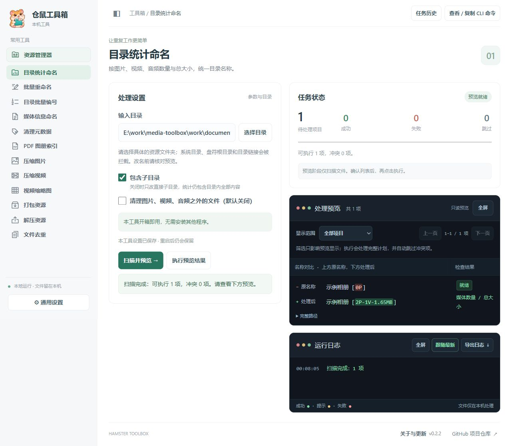
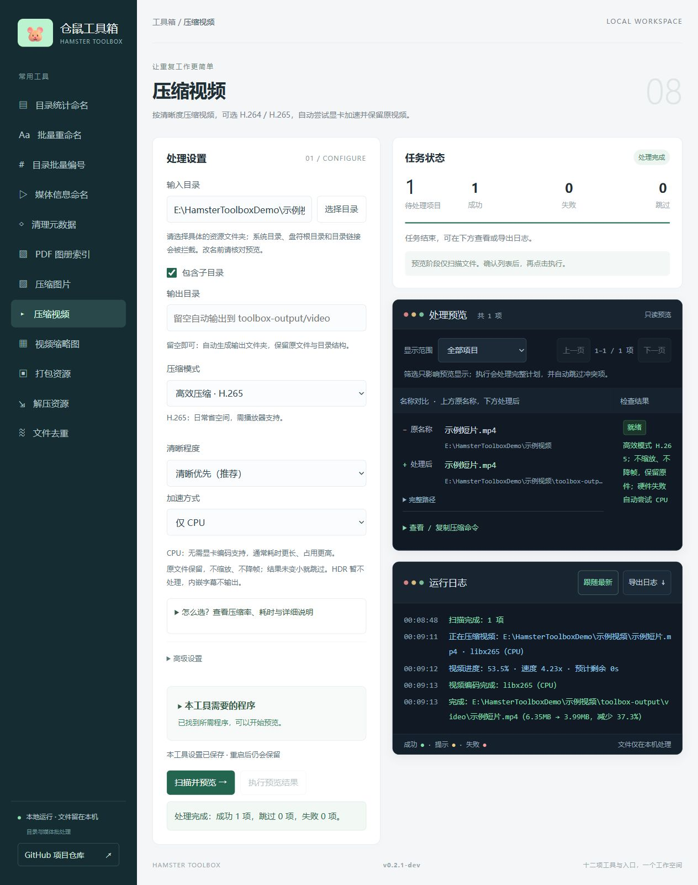
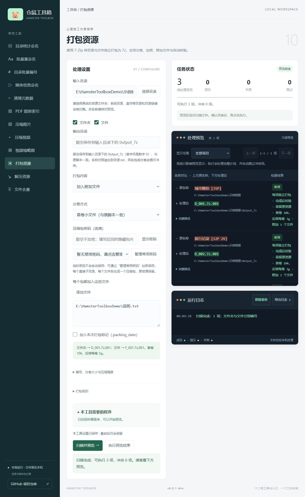

# 🐹 仓鼠工具箱

一个 Windows 本地文件与媒体处理工具箱，支持批量改名、目录整理、图片和视频处理。文件在本机处理，界面通过浏览器操作。

想知道每个工具能做什么？查看 [12 项工具的输入与输出示例](docs/examples.md)。

## 功能

- **整理与命名**：更新目录统计、按文字或编号示例批量改名、自定义目录编号与续号；可选清理非媒体文件。
- **图片与图册**：压缩 JPEG / PNG / 静态 WebP，清理图片和视频元数据，生成 PDF 图册索引。
- **视频与信息**：H.264 / H.265 压缩，显卡或 CPU 编码与自动回退，生成缩略图拼图，按媒体信息命名；可复制压缩命令。
- **打包与解压**：7-Zip 打包为 7z，支持分卷、加密和附加文件；批量解压 7z / ZIP / RAR 及分卷包，共用常用密码列表。
- **文件去重入口**：打开单独安装的 Video Duplicate Finder，查找重复或相似的视频、图片。

## 界面预览

左侧设置，右侧查看任务状态、处理前后对比和运行日志。依赖设置默认折叠。

**目录统计命名：扫描后对比原名称与新名称**

**视频压缩：选择模式与加速方式，查看压缩结果**

**7-Zip 打包：添加说明文件，预览分卷名称与输出位置**

截图使用临时生成的示例文件，不含个人资源或密码；截图中的体积与耗时不代表通用性能。

## 使用

1. 从 [Releases](https://github.com/sizhaiwu/hamster-toolbox/releases) 下载完整版并完整解压；尚无发布包时可按开发文档自行打包。
2. 双击 `hamster-toolbox.exe`，也可使用 `start-toolbox.cmd`。
3. 选择工具和输入目录，点击“扫描并预览”，检查后执行。

面向 **Windows 10/11 64 位**。完整版内置批处理所需组件，无需安装开发环境；文件去重软件需另行下载。改名会直接修改名称，清理文件和解压后清理原包均默认关闭，请先检查预览。

## 文档

- [一键准备体验素材](samples/README.md)：双击 `try-samples.cmd`，用合成素材体验各项功能。
- [使用指南](docs/usage.md)
- [各工具输入与输出示例](docs/examples.md)
- [CLI 命令行与页面复制命令](docs/cli.md)（开发版）
- [各工具 CLI 参数手册](docs/cli-reference.md)（开发版）
- [开发与测试](docs/development.md)
- [打包与发布](docs/packaging.md)
- [外部组件与配置](docs/dependencies.md)
- [安全与数据保护](docs/safety.md)

## 许可证

项目代码采用 [MIT](LICENSE) 许可证。随包外部组件遵循各自的许可证，见 [第三方说明](release/THIRD-PARTY.txt)。
