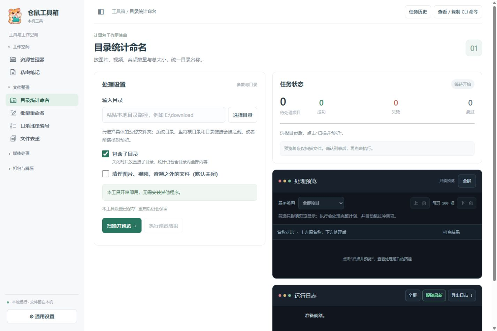
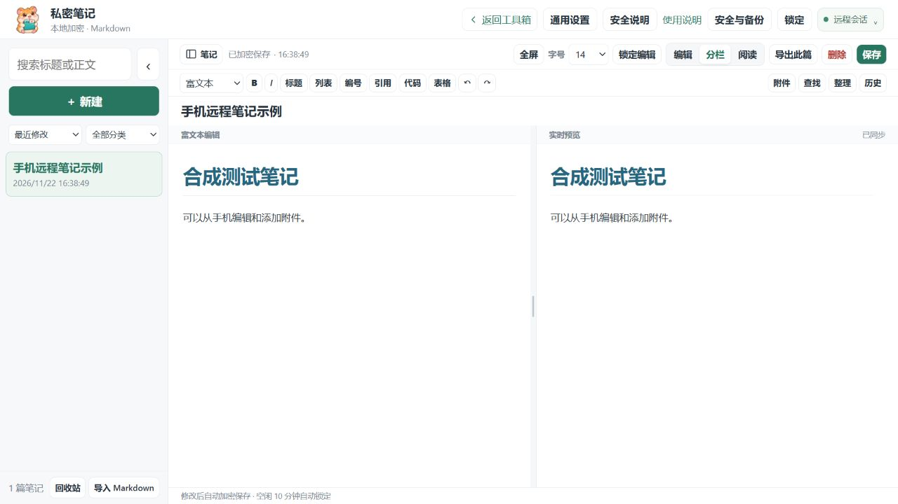
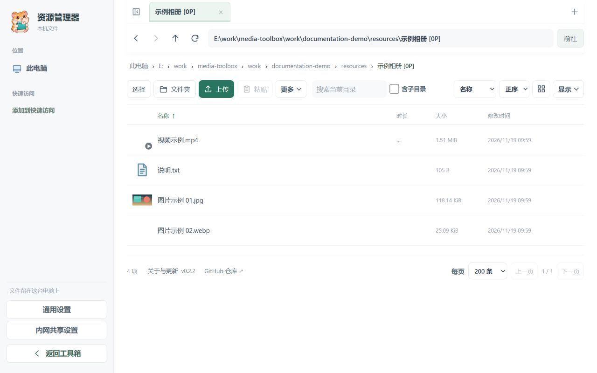

<h1 align="center">仓鼠工具箱</h1>

整理、处理和收藏本地资源的工具箱。通过浏览器操作，在本机处理文件；也能用命令行批处理，或共享资源给手机和其他电脑。

## 能做什么

- **私密笔记**：本地加密的富文本 / Markdown 笔记，支持图片文件、历史、回收站和自动备份。[使用说明](docs/private-notes.md)。
- **整理命名**：目录统计命名、批量重命名、自定义目录编号与续号、按媒体信息命名。
- **图片与视频**：清理元数据、压缩图片和视频、生成视频缩略图拼图、PDF 图册索引。
- **打包与解压**：7-Zip 加密、分卷、附加说明文件；识别常见及仅有 `.001/.002` 后缀的分卷，显示解压进度，管理常用密码。
- **资源管理器**：多标签、快速访问、自然排序、图片缩放、视频时长、缩略图列表、大目录搜索、文件夹上传与续传、复制与跨盘移动、改名和删除。
- **多种观看方式**：浏览器预览、悬停播放、多窗口悬浮查看；本机可用 mpv 独立窗口，优先硬件解码。
- **共享与自动化**：多个目录或磁盘根目录共享，适配电脑、手机和平板；提供 CLI 和页面复制命令。去重可打开另行安装的 Video Duplicate Finder。
- **完整远程工作台**：独立管理员登录，从手机使用工具箱、资源管理器和私密笔记。[开启方法](docs/remote-workspace.md)。

[全部功能](docs/features.md) · [输入输出示例](docs/examples.md) · [文档目录](docs/README.md)

## 开始使用

1. 在 [Releases](https://github.com/sizhaiwu/hamster-toolbox/releases) 下载 **Windows x64 安装包 `*-setup.exe`**；喜欢便携版可选择完整 ZIP。源码包和 `*-update.zip` 不能单独使用，旧版可能不含本文全部功能。
2. 安装后使用桌面或开始菜单快捷方式；便携版完整解压后运行 `hamster-toolbox-desktop.exe`。工具箱会在浏览器中打开，托盘可再次打开或退出。
3. 批处理先“扫描并预览”，核对后执行；浏览文件则进入左侧“资源管理器”。

顶部[任务历史](docs/task-history.md)可查看执行结果；图片/视频压缩、元数据清理及视频缩略图支持重扫失败和未完成文件，核对后继续处理。

Windows 完整版内置媒体处理、7-Zip 和 mpv 组件，无需安装 Go、Python 或 Node.js。去重软件需另行下载；Linux/macOS 请[从源码构建并准备本机依赖](docs/platforms.md)。

需要控制台或 CLI 时使用 `hamster-toolbox.exe` / `start-toolbox.cmd`。安装版和便携版可选择 Windows 登录后静默自启（默认关闭）；工具箱页面底部“关于与更新”显示当前版本和最新正式版，详见[安装与更新](docs/installation.md)。

先用[合成体验素材](samples/README.md)试用。媒体处理默认保留原件；改名直接修改名称，文件清理默认关闭。其他设备需先在本机开启共享，远程访问见[加密组网与内网穿透](docs/remote-access.md)。

## 界面预览

**工具箱页面**：工具分组可折叠；设置在左，任务状态、处理预览和运行日志在右。

**笔记页面**：支持富文本和 Markdown 分栏、图片文件附件、全屏和侧栏折叠。

**资源管理器**：支持文件预览、视频时长和多种观看方式。

截图只使用合成素材，用于展示主要操作，具体按钮以当前版本为准。更多操作见[使用指南](docs/usage.md)、[私密笔记](docs/private-notes.md)、[资源管理器](docs/file-browser.md)和[媒体预览](docs/media-preview.md)。

其他设备访问的[口令页和登录后界面](docs/remote-access.md#访客访问示例)见远程访问文档。

## 文档与开发

文档以当前源码为功能基线，详细功能和限制集中维护在 [docs](docs/README.md)。本版变化见 [v0.2.4 发布说明](docs/releases/0.2.4.md)。版本号以 [VERSION](VERSION) 和实际程序为准；[版本变更](CHANGELOG.md)会区分待发布内容和正式版本，文档更新不代表已经发布。

- 使用：[CLI 入门](docs/cli.md) · [参数手册](docs/cli-reference.md) · [常见问题](docs/faq.md)
- 维护：[开发](docs/development.md) · [测试](docs/testing.md) · [打包](docs/packaging.md) · [组件](docs/dependencies.md) · [安全](docs/safety.md)

项目代码采用 [MIT](LICENSE) 许可证。Go 运行时与模块许可见 [Go 依赖声明](release/GO-DEPENDENCIES.txt)。第三方组件保留各自许可证，见[第三方说明](release/THIRD-PARTY.txt)；仓鼠形象见[品牌素材](docs/brand/README.md)。
