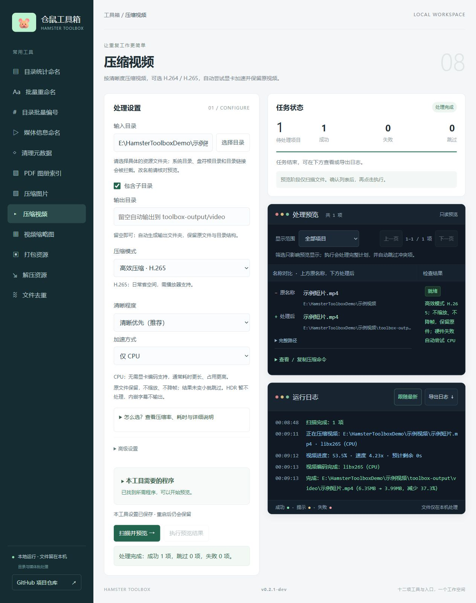
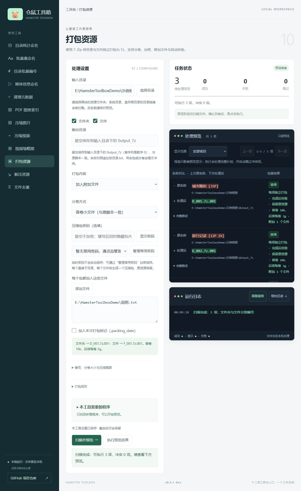

# 各工具的输入与输出示例

[返回首页](../README.md) · [详细操作指南](usage.md)

以下全部使用虚构目录和资源名。路径、数量、体积用于说明功能，不代表压缩效果或性能承诺。先扫描预览，再执行；修改设置后重新扫描。

想直接动手？仓库已提供 [合成体验素材和一键准备脚本](../samples/README.md)，涵盖以下全部工具；无需寻找自己的媒体文件。

## 目录统计命名

**用途**：按目录里实际的图片、视频、音频数量和总体积更新名称，兼容旧统计写法。

输入目录填 `E:\示例资源`，其中有：

```text
示例资源/
└─ 城市随拍 [35P]/
   ├─ 照片01.jpg
   ├─ 照片02.jpg
   └─ 照片03.jpg
```

假设实际三张图片合计 1.50 MB，执行后为：

```text
示例资源/
└─ 城市随拍 [3P-1.50MB]/
   └─ 原有三张图片
```

直接修改目录名，内部媒体保留。可选清理非媒体文件，默认关闭；开启后 TXT、URL、字幕和压缩包等会列入清理预览。默认移入回收站，也可明确选择永久删除。输入目录本层的文件保留。


## 批量重命名

**用途**：替换名称、添加前后缀；按编号示例替换时无需编写正则。

输入目录填 `E:\示例资源`，选择“按示例”，示例填 `test 第001期`，替换为留空：

| 输入名称 | 执行后的名称 |
| --- | --- |
| `test 第001期 城市随拍` | `城市随拍` |
| `test 第002期 旅行记录` | `旅行记录` |

保留默认“编号可变”和“只替换名称开头”。直接修改原名；可限定只改文件或只改目录。

## 目录批量编号

**用途**：给新增目录按顺序编号，也能识别旧编号并续号。

输入目录填 `E:\待编号`，样式选“仅编号”，起始编号填 `29`，位数填 `3`，保留原目录名：

| 输入子目录 | 执行后的子目录 |
| --- | --- |
| `城市随拍` | `029 - 城市随拍` |
| `旅行记录` | `030 - 旅行记录` |

资源名称可留空。关闭“保留原目录名”可得到 `029`、`030`。仅处理输入目录的直接子目录，内部文件保留；自定义模板可使用 `{number}` 和可选的 `{name}`。

## 媒体信息命名

**用途**：把分辨率、时长和体积写进音视频文件名，方便查看。

输入目录填 `E:\示例视频`：

```text
输入：示例视频/旅行短片.mp4
输出：示例视频/旅行短片「1920x1080,01分23秒,12.34MB」.mp4
```

数字取自实际文件。直接修改文件名，不转码；音频没有分辨率部分，已有的信息后缀会更新。

## 清理元数据

**用途**：去掉图片、视频中的作者、标题、注释等可清理标签，生成副本。

输入目录填 `E:\示例媒体`，类型选“图片和视频”，输出留空：

```text
输入：示例媒体/相册/照片.jpg
      示例媒体/视频/短片.mp4
输出：示例媒体/toolbox-output/exif/相册/照片.jpg
      示例媒体/toolbox-output/exif/视频/短片.mp4
```

原文件保留，视频不重新编码。元数据清理不能去除画面水印或片头广告；图片方向、色彩显示可能受影响，请检查副本。

## PDF 图册索引

**用途**：把多个资源目录的名称和封面整理成 PDF，快速浏览图册。

输入目录填 `E:\示例相册`，输出留空：

```text
输入：示例相册/城市随拍/封面.jpg
      示例相册/旅行记录/封面.jpg
输出：示例相册/toolbox-output/目录索引.pdf
```

每个直接子目录一页，使用第一张可解码图片作为封面；无图时生成标题页。原目录和图片保留。这是封面图册索引，不是 PDF 书签目录。

## 压缩图片

**用途**：缩小 JPEG、PNG、静态 WebP 文件的体积，并保留原图。

输入目录填 `E:\示例图片`，选择“仅 JPG”或自选格式，输出留空：

```text
输入：示例图片/相册/照片.jpg
输出：示例图片/toolbox-output/image/相册/照片.jpg
```

按选择的格式处理；未选格式不参与压缩。结果未变小或已有同名输出时跳过。

PNG 可选无损优化，或高画质 WebP 编码。选择“使用 .webp 后缀”时，`图像.png` 输出为 `图像.webp`；选择“保留 .png 文件名”时，后缀仍为 `.png`，实际内容是 WebP，须确认查看软件兼容。

## 压缩视频

**用途**：在清晰度、体积和速度之间选择合适的编码方式。

输入目录填 `E:\示例视频`，选择“高效压缩 · H.265”，输出留空：

```text
输入：示例视频/旅行/短片.mov
输出：示例视频/toolbox-output/video/旅行/短片.mp4
```

原视频保留。可选兼容 H.264、高效 H.265 或 CPU 精细模式，并选择自动、NVIDIA、Intel、AMD 或 CPU 编码；加速不可用时按规则回退。输出未变小时保留原片并跳过保存。小文件可能被体积或码率阈值过滤，可在高级设置中调整。预览里可以查看、复制独立压缩命令。



## 视频缩略图

**用途**：把视频不同时间的画面拼成一张预览图，不用逐个打开视频。

输入目录填 `E:\示例视频`，默认 JPEG、5 行 × 5 列，输出留空：

```text
输入：示例视频/旅行/短片.mp4
输出：示例视频/视频预览图/旅行/短片.mp4.jpg
```

拼图可显示文件信息和各画面的时间，可调整行列、宽度、间距和背景。原视频保留。

## 打包资源（7-Zip）

**用途**：每个直接子目录或符合条件的文件分别打包，便于分批保存、更新或分享。

输入目录填 `E:\待打包`，默认分卷规则，输出留空：

```text
输入：待打包/城市随拍/照片01.jpg
      待打包/旅行短片.mp4
输出：待打包/0utput_7z/D_001.7z.001
      待打包/0utput_7z/D_001.7z.002   （需要后续分卷时）
      待打包/0utput_7z/F_001.7z.001
      待打包/0utput_7z/目录.txt
```

`D_` 表示目录，`F_` 表示文件，两者分别编号；`0utput_7z` 开头是数字 0。可设密码、分卷大小，或加入每个包都需要的说明文件。附加文件每行一个路径，仅复制读取，原件保留。常用密码由工具箱按 Windows 账户加密保存。



## 解压资源

**用途**：批量解压 7z、ZIP、RAR 及支持的分卷包。

输入目录填 `E:\待解压`，采用默认“按包名建目录”和“自动重命名新文件”，输出留空：

```text
输入：待解压/城市随拍.zip
      包内有：照片.jpg
输出：待解压/解压资源/城市随拍/照片.jpg
```

已有 `照片.jpg` 时，新文件自动改为 `照片_1.jpg`，也可选择跳过或覆盖。分卷须放在同一目录，从首卷识别为一组；加密包在扫描前输入密码。原包默认保留，可勾选完整解压后清理原包，选择回收站或永久删除。

## 文件去重入口

**用途**：打开本机 Video Duplicate Finder，查找重复或相似的视频、图片。

```text
软件路径示例：E:\软件\VideoDuplicateFinder\VDF.GUI.exe
在外部软件中添加：E:\示例媒体
扫描结果示例：
  照片.jpg ↔ 照片_副本.jpg      （疑似重复图片）
  短片.mp4 ↔ 短片_另存.mp4     （疑似重复视频）
```

工具箱不直接生成去重后的目录，也不自动删除重复文件。需单独安装该软件，在它的窗口中核对分组、选择保留文件并处理；工具箱的路径保护不适用于外部软件内的操作。
