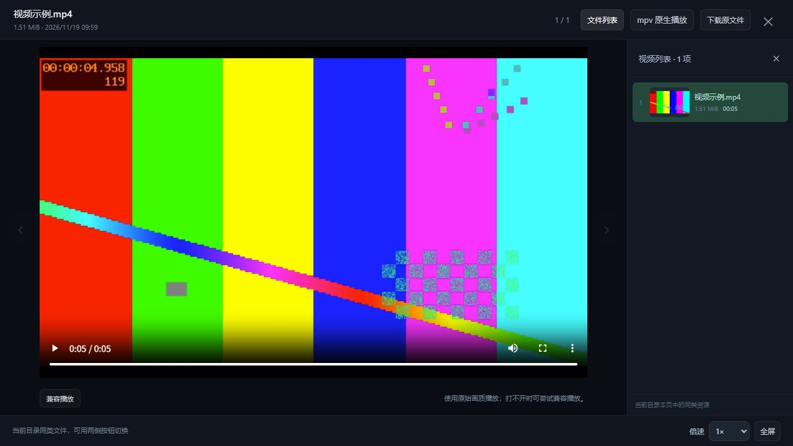

# 图片与视频预览

[文档目录](README.md)

[资源管理器](file-browser.md) · [组件设置](dependencies.md)

## 使用方式

- 将真实鼠标停在视频项目约半秒，即可在缩略图位置静音循环预览最多前 6 秒；移开、滚动、切换目录或打开完整预览时停止。图标视图的画面更大，列表视图也可预览。触屏操作不触发，触屏电脑连接鼠标后可以使用。工具栏“显示 → 悬停预览：开/关”可随时关闭，设置会记住；需要减少流量或动态画面时可关闭。
- 加载时显示“准备预览 / 加载预览”；失败会保留封面并显示原因，也可双击视频使用完整播放器。悬停需要真实鼠标事件，触屏点击不触发短片。
- 悬停预览按需生成低分辨率 H.264 短片，不依赖原视频是否能在浏览器直接播放；首次需要短暂等待，失败时保留封面，双击后仍可使用完整播放器。
- 普通图片和视频优先直接打开，保留原始画质，减少 CPU 占用。双击打开视频，或通过左右按钮、缩略图和文件列表切换视频时，会自动开始播放并优先开启声音；浏览器限制有声自动播放时尝试静音播放，可在播放器内开启声音。若静音也被阻止，会提示点击播放。手动暂停后不会因后台读取视频信息而重新播放。
- 分片 MP4 自动切换到兼容播放，通常可以直接复制画面和音轨来修复播放封装。
- 其他视频无法播放时自动尝试兼容模式，也可点击“兼容播放”。画面编码已适合浏览器时复制画面；不适合时实时转换成 H.264/AAC，最高 720p。
- 仍有问题时点击“强兼容播放”，强制转换画面和音轨。该模式会使用更多 CPU，预览画质与原视频可能不同。
- 兼容模式使用画面正下方的“全片进度”跳转，右侧显示完整视频时长。浏览器播放器自带进度可能只显示当前缓冲片段；即使那里只有几秒，也不代表原视频变短。复制画面时，跳转位置可能对齐到附近的关键帧。可随时切回“原始播放”，或下载原文件。
- 浏览器无法显示的图片会尝试转换为 JPEG 显示副本，最大 2560×2560；透明区域显示为白色。原图的尺寸、透明度、动画和文件内容不受影响。

这些操作只影响预览，不覆盖、移动或删除源文件，也不生成与原视频同样大小的临时文件。

## 缩略图、侧栏与时长

双击图片或视频后，可用底部缩略图切换同类资源，或打开顶部“文件列表”显示侧栏。侧栏包含缩略图、名称和大小，视频另显示时长，例如 `1.51 MiB · 00:05`。手机侧栏可单独关闭，不影响当前播放。

目录列表、图标和预览侧栏共用时长缓存及最多 2 个并发探测；同一视频进行中的读取不重复提交。只读取可视区域附近的文件，隐藏侧栏、关闭预览或切换目录会取消对应的未完成读取。读取失败显示“未知”，不阻止打开文件。没有批量加载全部原视频来获取时长。

图片属性显示像素分辨率与实际编码；视频属性显示时长、分辨率和可读取的编码信息。后缀与实际编码可能不同；属性读取失败时仍显示基本文件信息。

## 多窗口悬浮查看

本机视频建议右键选择 **“原生悬浮播放（mpv）”**：直接读取磁盘文件，无需 HTTP 视频传输或服务端转码，优先硬件解码。Windows 完整版包含 mpv；Linux/macOS 可安装系统 mpv，或在工具栏“显示 → 原生播放器 → 程序位置与下载”中指定程序。

双击打开视频后，也可点击预览顶部的 **“mpv 原生播放”**。切换时暂停浏览器视频，启动成功后关闭网页预览并释放视频读取；启动失败会保留预览并显示程序设置指引。此按钮仅在本机的视频预览中显示。

本机图片也可右键选择 **“原生悬浮查看（mpv）”**，在浏览器外独立显示，并可同时打开多张。支持调整窗口大小和置顶，静态图片持续显示至手动关闭；`Ctrl+滚轮` 缩放，`Ctrl+左键拖动` 平移图片，普通左键拖动移动窗口，双击切换全屏。格式支持取决于 mpv 的解码器；原文件不会修改。共享访客不启动主机上的原生窗口。

- 每个视频独立窗口，可拖动、调整大小和置顶到其他软件上方；鼠标移入后显示播放器控件，分别控制进度和声音，默认开启声音，可单独静音。
- 初始窗口按屏幕约 75% 宽、80% 高的区域适应媒体比例，竖屏媒体按显示比例适配。控制条不随小窗口等比例缩成难以辨认的文字；移开鼠标后自动隐藏。
- 工具栏“显示 → 原生播放器”显示实际解码方式，例如 `d3d11va`；显示“CPU 软件解码”时表示当前视频没有使用硬解。硬解是否可用取决于编码、显卡与驱动，不保证所有视频都能硬解。
- 切换目录、刷新或关闭网页不会关闭原生窗口；可直接关闭窗口，或在“原生播放器”中暂停、静音、取消置顶或关闭。工具箱重启后不会接管之前的窗口，旧窗口可继续独立使用。
- 不限制窗口数量；总吞吐量仍受显卡解码能力、显存、CPU 和磁盘影响。多路高分辨率视频超出硬件能力时，请减少窗口数。
- 原生启动与控制仅限本机管理页面；共享访客与手机使用浏览器播放器，不会启动或控制主机的 mpv。[mpv 硬解与控件说明](https://mpv.io/manual/stable/)

浏览器模式：右键图片选择“悬浮查看”，本机视频选择“浏览器悬浮播放”，共享视频选择“悬浮播放”；手机可点击项目的“···”菜单。不设置悬浮窗口数量上限，切换目录、资源标签页或打开其他普通预览不会关闭它们。

- 拖动标题栏移动，拖动右下角调整大小；键盘聚焦标题栏或右下角后，可用方向键移动或调整大小。
- 桌面端标题栏覆盖在画面上，平时隐藏，鼠标移入窗口、键盘聚焦控件或打开选项时显示，不占用画面高度；触屏设备保留可见操作入口。
- 图片不显示底部缩放栏；电脑用滚轮缩放，手机用双指缩放，放大后拖动平移。双击图片或聚焦图片后按 `0` 恢复适应，键盘 `+/-` 也可缩放。右下角拖动调整窗口大小，缩放手柄始终位于媒体上层。
- “置顶”让该窗口高于其他页面内悬浮窗口；点击普通窗口可将它移到普通窗口最上层。可收起、展开或单独关闭。
- 浏览器视频为兼容自动播放而静音启动，使用浏览器自带控件分别控制进度、音量与倍速，没有常驻的额外底部控制栏。标题栏“···”菜单提供兼容播放、小尺寸的系统画中画按钮和按需显示的“全片进度”，各个视频仍相互独立。窄窗口标题会省略，保留关闭等操作。
- 页面左下角可整理窗口、全部暂停视频或全部关闭。“整理”只调整位置，保留每个窗口当前的宽高和收起状态；空间不够时错开叠放。关闭时停止媒体读取和转码，不修改原文件。刷新页面、离开资源管理器页面或共享登录失效后关闭，不自动恢复。
- 原始播放不额外转码；兼容视频仍受服务最多 2 路的限制，其他窗口可继续显示图片或原始播放的视频。
- 支持的浏览器会额外提供视频“画中画”，可显示在其他软件上方；系统画中画通常只允许一个，受浏览器和权限限制。图片与多窗口置顶默认在资源管理器页面内。[浏览器画中画说明](https://developer.mozilla.org/en-US/docs/Web/API/HTMLVideoElement/requestPictureInPicture)

## 常见格式

| 资源 | 处理方式 |
| --- | --- |
| JPG/JPEG/JPE/JFIF、PNG、GIF、WebP、BMP | 优先原图，支持缩略图；GIF 原图保留动画，缩略图取首帧 |
| AVIF、HEIC/HEIF、TIF/TIFF | 生成缩略图；原图无法显示时使用兼容图片预览，需要 ImageMagick 对应解码器 |
| MP4/M4V/MOV、分片 MP4 | 普通视频原始播放；分片 MP4 自动尝试修复封装 |
| MKV、AVI、WebM、TS/MTS/M2TS、WMV/ASF、FLV/F4V、MPG/MPEG、3GP/3G2 | 可生成封面；原始播放失败时尝试兼容播放 |
| VOB、M2V、RM/RMVB、OGV、DIVX、MXF | 提供视频入口及兼容尝试，实际支持取决于 FFmpeg 编译时包含的解码器 |
| H.264 8 位画面 | 兼容模式通常可以复制画面，不必降低分辨率或重新编码 |
| H.265/HEVC、10 位视频、MPEG-4、WMV 等编码 | 设备支持时可原始播放，否则按需转换预览 |

封装和编解码是不同的层次，无法只根据后缀保证设备一定能直接播放。损坏文件、加密媒体、缺失解码器及特殊编码参数仍可能失败。[浏览器格式说明](https://developer.mozilla.org/en-US/docs/Web/Media/Guides/Formats/Containers)

## 性能与组件

- 附近的缩略图按需低优先级加载。普通 MP4 原始播放只轻量检查封装头，不额外运行 FFprobe；需要兼容播放时才探测完整信息，不会扫描目录时转换整批视频。
- 浏览器原始播放的单段 Range 请求按本机 1 MiB、共享 256 KiB 返回，保留连续读取与跳转，及时释放 HTTP 连接，减少多个长视频占住连接后影响图片或操作请求。下载原文件不截短。原生 mpv 直接读文件，不占浏览器视频连接。
- 每个页面同时只悬停播放一个视频；服务最多同时生成一个悬停短片，与完整兼容播放器使用独立名额。短片最高 480×360、12 帧/秒、6 秒、无音轨，生成超时或离开项目后取消请求；最近使用的短片最多缓存 24 项且总计 16 MiB，文件变化后重新生成，缓存不落盘。
- 视频通过已验证的文件句柄交给 FFmpeg/FFprobe，可以直接随机读取；不需要绕经内部 HTTP 索引整个分片视频。旧 FFmpeg 不支持此方式时，普通封面保留兼容读取；实时兼容播放会提示升级。[FFmpeg fd 协议](https://ffmpeg.org/ffmpeg-protocols.html#fd)
- 元数据最多缓存 1024 项；缩略图内存缓存最多 128 项且总计 16 MiB，兼容图片最多 12 项且总计 32 MiB。缩略图另有持久磁盘缓存，默认上限 256 MB，位于数据目录的 `thumbnails`，可在通用设置中关闭或清空；兼容图片和媒体信息缓存仍在内存中。文件大小或修改时间变化后使用新缓存键。
- 最多同时处理 2 路兼容播放、2 个图像转换任务；视频编码最多使用 2 个线程。关闭或切换预览会取消旧请求，停止对应转换。
- 普通原始播放不受这 2 路限制。兼容播放每路最长 8 小时，可重新打开继续；先缓冲少量内容，再按接近播放速度读取，避免快速处理整片。播放暂停后通过网络背压减少继续转换，连接取消会释放进程。
- 图片有输入大小、尺寸、处理时间和像素缓存限制，第三方解码器的额外内存仍取决于实际格式；超出限制时提示下载查看。

优先使用已保存的 FFmpeg、FFprobe、ImageMagick 路径。Windows 完整包含所需组件；Linux/macOS 需安装支持 `fd` 协议的 FFmpeg/FFprobe 和带相应解码器的 ImageMagick。源码构建也可以在组件设置中选择程序路径，不会擅自修改系统组件。
