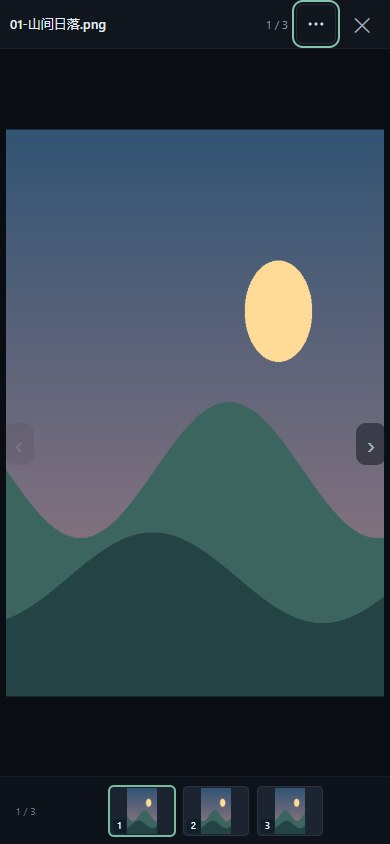
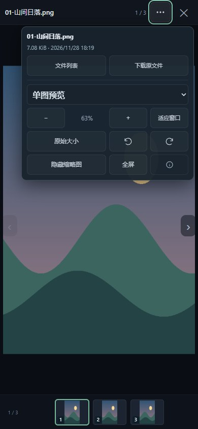
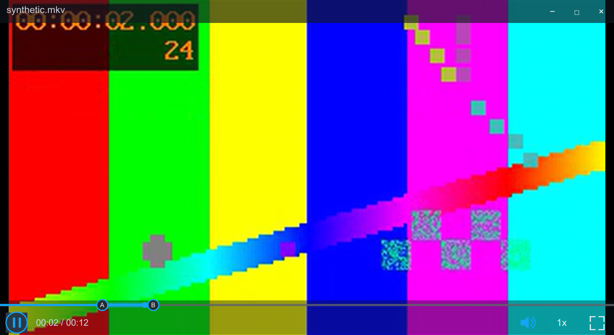

# 图片与视频预览

[文档目录](README.md)

[资源管理器](file-browser.md) · [组件设置](dependencies.md)

## 使用方式

- 将真实鼠标停在视频项目约半秒，即可在缩略图位置静音循环预览最多前 6 秒；移开、滚动、切换目录或打开完整预览时停止。图标视图的画面更大，列表视图也可预览。触屏操作不触发，触屏电脑连接鼠标后可以使用。工具栏“显示 → 悬停预览：开/关”可随时关闭，设置会记住；需要减少流量或动态画面时可关闭。
- 加载时显示“准备预览 / 加载预览”；失败会保留封面并显示原因，也可双击视频使用完整播放器。悬停需要真实鼠标事件，触屏点击不触发短片。
- 悬停预览按需生成低分辨率 H.264 短片，不依赖原视频是否能在浏览器直接播放；首次需要短暂等待，失败时保留封面，双击后仍可使用完整播放器。
- 普通图片和视频优先直接打开，保留原始画质，减少 CPU 占用。双击打开视频，或通过左右按钮、缩略图和文件列表切换视频时，会自动开始播放并优先开启声音；浏览器限制有声自动播放时尝试静音播放，可在播放器内开启声音。若静音也被阻止，会提示点击播放。手动暂停后不会因后台读取视频信息而重新播放。
- 分片 MP4 自动切换到兼容播放，通常可以直接复制画面和音轨来修复播放封装。
- 其他视频无法播放时自动尝试兼容模式，也可点击“兼容播放”。画面编码已适合浏览器时复制画面；不适合时实时转换成 H.264/AAC，最高 720p。
- 仍有问题时点击“强兼容播放”，强制转换画面和音轨。该模式会使用更多 CPU，预览画质与原视频可能不同。
- 兼容模式点击顶部“全片进度”打开悬浮选项框并跳转，框内显示完整视频时长；首次进入兼容模式会自动展开，避免误将缓冲片段时长当作全片时长。浏览器播放器自带进度可能只显示当前缓冲片段；即使那里只有几秒，也不代表原视频变短。复制画面时，跳转位置可能对齐到附近的关键帧。可随时切回“原始播放”，或下载原文件。
- 浏览器无法显示的图片会尝试转换为 JPEG 显示副本，最大 2560×2560；透明区域显示为白色。原图的尺寸、透明度、动画和文件内容不受影响。

网页视频预览将倍速、全屏与播放选项集中在顶部，画面不再被常驻兼容工具栏挤压。视频缩略图在画面下方的独立底栏显示，不覆盖视频或浏览器原生播放控件；可通过顶部“隐藏缩略图”收起。倍速选择在当前浏览器中记忆，切换视频及兼容源后继续使用。打开或收起选项与文件列表不重载正在播放的视频。

这些操作只影响预览，不覆盖、移动或删除源文件，也不生成与原视频同样大小的临时文件。

## 手机预览

顶部保持单行；点击“更多”查看文件信息、下载、文件列表，以及图片缩放／旋转或视频播放选项。按钮按用途紧凑排列；手机仍可双指缩放图片，视频缩略图留在画面下方。

 

## 桌面端观看

在 **通用设置 → 播放** 可分别设置图片和视频的默认预览：当前页、页面内悬浮、仓鼠独立窗口或 mpv 原生播放器。桌面端默认使用仓鼠独立预览窗口；浏览器和手机默认使用当前页。选择后自动保存，重启仍有效；独立窗口仅桌面端可用，mpv 仅本机可用，不支持时使用当前页预览。原“自动选择”已移除，旧的自动设置采用新的固定默认值；明确选择的其他方式继续保留。

- 右键媒体项目的 **打开方式** 子菜单集中提供当前页、仓鼠独立窗口、页面内悬浮、mpv 和其他程序；主菜单保留“按默认方式打开”。电脑支持悬停、点击与方向键，手机点击展开并可返回。子菜单末尾可进入默认预览设置；临时选择不会改动默认值，预览内切换上下张沿用当前方式。远程访问不显示本机播放器入口。
- 默认在独立预览窗口打开图片和普通视频，可以移出主窗口、调整大小和置顶；图片与视频分别记住窗口位置和大小。关闭或按 Esc 只关闭当前预览，主资源管理器与后台任务保留。预览窗口不在启动时自动重新播放。
- 桌面端当前页与独立预览的顶部工具栏均悬浮在画面上，鼠标移入或键盘聚焦时淡入，移出后淡出，不占用媒体高度；操作提示或播放选项展开期间保持显示。手机端顶部仅保留单行文件名、序号、更多和关闭按钮，长名称省略显示；完整名称、大小、下载、文件列表及缩放／播放操作收在“更多”浮层中，按钮按文件操作与媒体操作紧凑分组，展开不挤压画面，横屏也适用。iPhone Chrome 普通网页不重复叠加顶部安全区留白；Safari、主屏幕模式和全屏继续保留系统安全区。电脑缩窄窗口时可换行；图片底部缩略图沿用悬浮方式，视频缩略图保留独立底栏。切换目录不会关闭已经打开的独立窗口。
- 桌面切图复用内存中的图片 URL，并按需预读前后图片。仅对尺寸可安全读取的小 JPEG 预解码，估算的预解码预算为 48 MiB、最多两张；超大或其他格式继续按需显示。原图不缩小、不重新编码；浏览器仍使用原有较保守的预读策略，远程访问与手机不启用桌面预解码。
- 桌面观看记录默认关闭。开启后记住视频进度、音量、倍速，以及图片的缩放、平移和旋转；按文件位置、大小和修改时间区分，文件更新后使用新记录。最多保留 500 条，保存在数据目录的 `desktop-profile/media-history.json`，使用路径摘要作为索引，不保存图片或视频内容。关闭记录会清除已保存的桌面记录，也可单独点击清除。
- “仅当前桌面预览窗口发声”默认关闭，适用于桌面内置预览窗口之间；关闭该选项会恢复由它临时静音的窗口。mpv 窗口之间使用下面的原生播放器声音选项。
- 独立预览读取通用播放设置，但不轮询普通任务完成弹窗，任务结果仍可在主窗口查看。

内置视频的快捷键：左右快进退 5 秒、Shift+左右精确跳转 1 秒、上下调整音量、M 静音、F 全屏；空格在画面区域暂停／继续，焦点在按钮或输入框时保留控件本来的操作。原生视频采用相同的主要操作；图片 R／Shift+R 旋转、0 适应窗口。F1 可查看桌面快捷键说明。输入框、编辑器和浏览器原生视频控件的键盘行为保留。

浏览器与远程访问继续使用网页预览、原来的 mpv 手动入口和兼容播放。Linux/macOS 当前使用浏览器界面；安装 mpv 后可使用下面的原生播放器增强功能，平台不支持窗口定位或焦点报告时使用手动控制。

## 缩略图、侧栏与时长

双击图片或视频后，可用底部缩略图切换同类资源，或打开顶部“文件列表”显示侧栏。侧栏包含缩略图、名称和大小，视频另显示时长，例如 `1.51 MiB · 00:05`。手机侧栏可单独关闭，不影响当前播放。

目录列表、图标和预览侧栏共用时长缓存及最多 2 个并发探测；同一视频进行中的读取不重复提交。只读取可视区域附近的文件，隐藏侧栏、关闭预览或切换目录会取消对应的未完成读取。读取失败显示“未知”，不阻止打开文件。没有批量加载全部原视频来获取时长。

图片属性显示像素分辨率与实际编码；视频属性显示时长、分辨率和可读取的编码信息。后缀与实际编码可能不同；属性读取失败时仍显示基本文件信息。

## 多窗口悬浮查看

本机视频建议右键选择 **“原生悬浮播放（mpv）”**：直接读取磁盘文件，无需 HTTP 视频传输或服务端转码，优先硬件解码。Windows 完整版包含 mpv；Linux/macOS 可安装系统 mpv，或在工具栏“显示 → 原生播放器 → 程序位置与下载”中指定程序。

双击打开视频后，也可点击预览顶部的 **“mpv 播放”**。切换时暂停浏览器视频，启动成功后关闭网页预览并释放视频读取；启动失败会保留预览并显示程序设置指引。图片预览顶部对应显示“原生查看”；远程访问不显示这些本机程序入口。

本机图片也可右键选择 **“原生悬浮查看（mpv）”**，在浏览器外独立显示，并可同时打开多张。支持调整窗口大小和置顶，静态图片持续显示至手动关闭；直接滚轮缩放，按 `0` 复位，`Ctrl+左键拖动` 平移图片，普通左键拖动移动窗口，双击切换全屏。格式支持取决于 mpv 的解码器；原文件不会修改。共享访客不启动主机上的原生窗口。

- 每个视频独立窗口，可拖动、调整大小和置顶到其他软件上方；鼠标移入后显示播放器控件，分别控制进度和声音，默认开启声音，可单独静音。
- 默认记住手动调整后的普通窗口大小，图片和视频分别记忆；全屏、最大化和平铺不覆盖手动记忆。关闭“记住调整后的窗口大小”后使用预设；选择不同预设可重置尺寸记忆。
- 管理面板提供“错开排列”（保持当前大小）、“平铺窗口”（改变大小）、全部暂停和静音，以及各视频独立进度/音量、图片缩放与复位；轮询保留正在操作的控件，窗口指令等待 mpv 确认，部分失败会显示数量。Linux Wayland 可能限制定位。
- 没有尺寸记忆时初始窗口默认“紧凑”，在 800×600 像素范围内按媒体比例适配，方便同时观看多个。资源管理器“显示 → 原生播放器 → 初始窗口大小”可选中等（1100×825）或较大（屏幕约 75% 宽、80% 高）；选择自动保存，重启仍有效，仅影响之后打开的图片与视频窗口，已有窗口保留手动调整的大小。控制条不随小窗口等比例缩成难以辨认的文字；移开鼠标后自动隐藏。
- 工具栏“显示 → 原生播放器”显示实际解码方式，例如 `d3d11va`；显示“CPU 软件解码”时表示当前视频没有使用硬解。硬解是否可用取决于编码、显卡与驱动，不保证所有视频都能硬解。
- 切换目录、刷新或关闭网页不会关闭原生窗口；可直接关闭窗口，或在“原生播放器”中暂停、静音、取消置顶或关闭。工具箱重启后不会接管之前的窗口，旧窗口可继续独立使用。
- 不限制窗口数量；总吞吐量仍受显卡解码能力、显存、CPU 和磁盘影响。多路高分辨率视频超出硬件能力时，请减少窗口数。
- 原生启动与控制仅限本机管理页面；共享访客与手机使用浏览器播放器，不会启动或控制主机的 mpv。[mpv 硬解与控件说明](https://mpv.io/manual/stable/)

浏览器模式：右键图片选择“悬浮查看”，本机视频选择“浏览器悬浮播放”，共享视频选择“悬浮播放”；手机可点击项目的“···”菜单。不设置悬浮窗口数量上限，切换目录、资源标签页或打开其他普通预览不会关闭它们。

- 拖动标题栏移动，拖动右下角调整大小；键盘聚焦标题栏或右下角后，可用方向键移动或调整大小。
- 桌面端标题栏覆盖在画面上，平时隐藏，鼠标移入窗口、键盘聚焦控件或打开选项时显示，不占用画面高度；触屏设备保留可见操作入口。
- 图片不显示底部缩放栏；电脑用滚轮缩放，手机用双指缩放，放大后拖动平移。双击图片或聚焦图片后按 `0` 恢复适应，键盘 `+/-` 也可缩放。右下角拖动调整窗口大小，缩放手柄始终位于媒体上层。
- “置顶”让该窗口高于其他页面内悬浮窗口；点击普通窗口可将它移到普通窗口最上层。可收起、展开或单独关闭。
- 浏览器悬浮视频优先有声播放，遵循通用设置中的“浏览器视频默认静音”。手机浏览器限制有声自动播放时会静音继续播放，窗口内显示“开启声音”，点击后仅开启当前视频的声音；有声后按钮隐藏。使用浏览器自带控件分别控制进度、音量与倍速，没有常驻的额外底部控制栏。标题栏“···”菜单提供兼容播放、小尺寸的系统画中画按钮和按需显示的“全片进度”，各个视频仍相互独立。窄窗口标题会省略，保留关闭等操作。
- 页面左下角可整理窗口、全部暂停视频或全部关闭。“整理”只调整位置，保留每个窗口当前的宽高和收起状态；空间不够时错开叠放。关闭时停止媒体读取和转码，不修改原文件。刷新页面、离开资源管理器页面或共享登录失效后关闭，不自动恢复。
- 原始播放不额外转码；兼容视频仍受服务最多 2 路的限制，其他窗口可继续显示图片或原始播放的视频。
- 支持的浏览器会额外提供视频“画中画”，可显示在其他软件上方；系统画中画通常只允许一个，受浏览器和权限限制。图片与多窗口置顶默认在资源管理器页面内。[浏览器画中画说明](https://developer.mozilla.org/en-US/docs/Web/API/HTMLVideoElement/requestPictureInPicture)

原生播放器统一使用一套控制栏：播放／暂停、进度、时间、音量、倍速和全屏，倍速和全屏位于音量旁边，同排显示。底部采用细蓝色进度条和圆形播放按钮，移除播放器内的快进退、音轨和字幕按钮。控制条以半透明形式悬浮在窗口底部，显示和隐藏不改变视频高度、缩放或位置；移开鼠标后自动收起，不使用居中大面板。悬停音量图标展开竖向音量滑条，可拖动或滚轮调节；点击图标切换静音。窄窗口会收起扩展操作，保持音量和播放按钮可用。控件按系统 DPI 显示，不因窗口变窄整体缩小。右上角保留最小化、最大化和关闭按钮，鼠标移入顶部时显示。图片显示专用缩放、复位和旋转按钮。已有简约版或全部隐藏设置会自动切换为统一界面；空格播放／暂停、上下调音量、M 静音、F 全屏、Q 关闭仍可使用。已打开的旧播放器需重新打开后使用新的控制条；浏览器控件不受影响。

在资源管理器“显示 → 原生播放器”中可设置 **视频结束后**，自动记忆并对新打开的视频生效：

| 动作 | 播完后的行为 |
| --- | --- |
| 停留最后一帧（默认） | 保留画面，点击播放可从头重播 |
| 循环当前视频 | 从头继续播放，无限循环 |
| 关闭当前播放器 | 只关闭播放完的那个 mpv 窗口 |

已打开的窗口沿用打开时的设置，图片查看不受影响。AB 重复启用时优先循环选定片段，取消后按所选结束动作播放。

原生 mpv 支持 **AB 重复播放**，请先让目标播放器窗口获得焦点：

- `Ctrl+1`：把当前播放位置设为 A 点，并清除旧 B 点。
- `Ctrl+2`：把当前位置设为 B 点，播放到 B 后自动返回 A，无限重复；B 必须晚于 A。
- `Ctrl+3`：清除 A、B，恢复正常播放。

进度条显示 A、B 标记和选定区间，短区间合并显示为 AB。暂停时设置不会自动播放，继续播放后循环；每个窗口独立，重新打开或切换文件后清除，不写入观看记录。循环由 [mpv 自带的 AB 循环功能](https://mpv.io/manual/stable/#options-ab-loop-a) 执行，不依赖网页轮询或重复转码。

原生播放器面板还支持倍速、媒体内嵌音轨／字幕选择、图片左右旋转及“全部恢复”。显示实际视频分辨率、硬解方式，以及播放器可报告的解码丢帧和显示丢帧；缺少对应能力时不显示虚构数值。

“记住原生观看位置与设置”默认关闭，开启后下次打开生效，mpv 在正常关闭时保存进度、音量、倍速、音轨／字幕和图片视图；修改过的文件不恢复旧进度。记录位于数据目录的 `native-watch-later/`，文件名采用 mpv 的路径摘要，关闭文件名注释；可从播放器面板清除，不触碰媒体文件。最多保留最近 500 条。“仅当前原生窗口发声”也是可选项；若平台无法报告窗口焦点，可使用每个视频的“仅此发声”。手动静音的窗口保留其选择。

## 常见格式

| 资源 | 处理方式 |
| --- | --- |
| JPG/JPEG/JPE/JFIF、PNG、GIF、WebP、BMP | 优先原图，支持缩略图；GIF 原图保留动画，缩略图取首帧 |
| AVIF、HEIC/HEIF、TIF/TIFF | 生成缩略图；原图无法显示时使用兼容图片预览，需要 ImageMagick 对应解码器 |
| MP4/M4V/MOV、分片 MP4 | 普通视频原始播放；分片 MP4 自动尝试修复封装 |
| MKV、AVI、WebM、TS/MTS/M2TS、WMV/ASF、FLV/F4V、MPG/MPEG、3GP/3G2 | 可生成封面；原始播放失败时尝试兼容播放 |
| VOB、M2V、RM/RMVB、OGV、DIVX、MXF | 提供视频入口及兼容尝试，实际支持取决于 FFmpeg 编译时包含的解码器 |
| H.264 8 位画面 | 兼容模式通常可以复制画面，不必降低分辨率或重新编码 |
| H.265/HEVC、10 位视频、MPEG-4、WMV 等编码 | 设备支持时可原始播放，否则按需转换预览 |

封装和编解码是不同的层次，无法只根据后缀保证设备一定能直接播放。损坏文件、加密媒体、缺失解码器及特殊编码参数仍可能失败。[浏览器格式说明](https://developer.mozilla.org/en-US/docs/Web/Media/Guides/Formats/Containers)

## 性能与组件

- 缩略图和时长按需读取，大目录先显示列表，再补齐媒体信息；不会先转换整个目录的视频。
- 缩略图缓存默认上限 256 MB，可在通用设置中关闭或清空。源文件改变后会重新生成。
- 普通播放优先使用原始媒体；兼容播放需要转换，最多同时两路。多路本机视频可选择 mpv，优先使用显卡解码。
- 切换文件或关闭预览会释放无用读取；省流量模式下减少预读。浏览器可用内存、解码器及媒体尺寸会影响速度。
- Windows 完整包包含所需组件；Linux/macOS 需安装 FFmpeg/FFprobe 和 ImageMagick。组件路径可在工具中选择，详见[依赖说明](dependencies.md)。

无法预览的格式可下载原文件，用相应应用打开；原文件不会因兼容预览而被修改。
