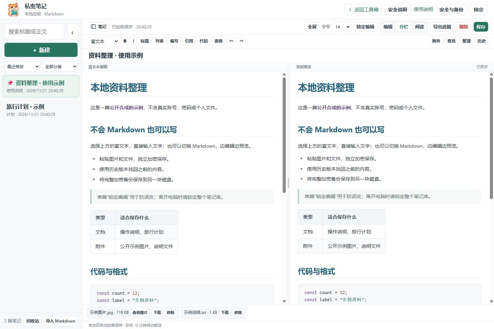
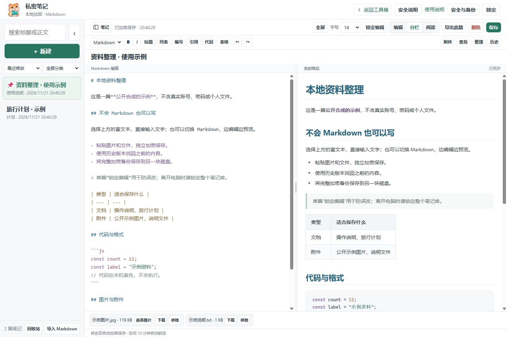
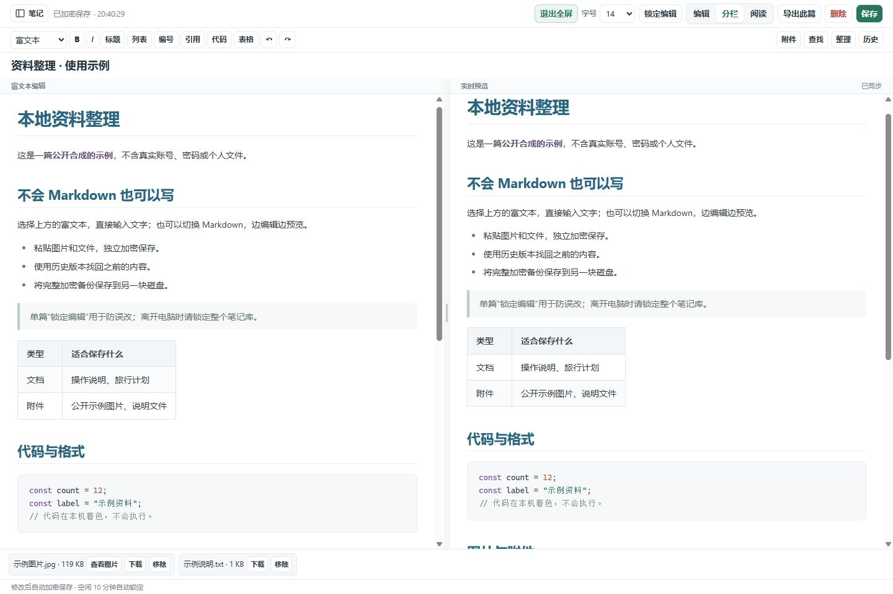
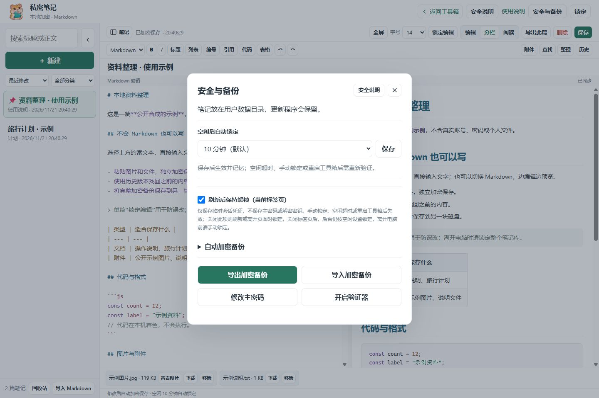
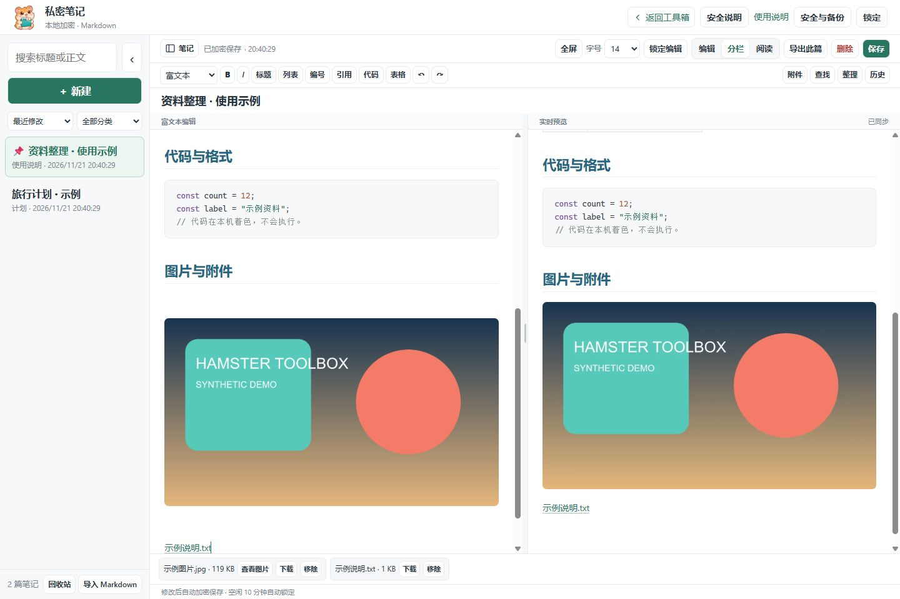
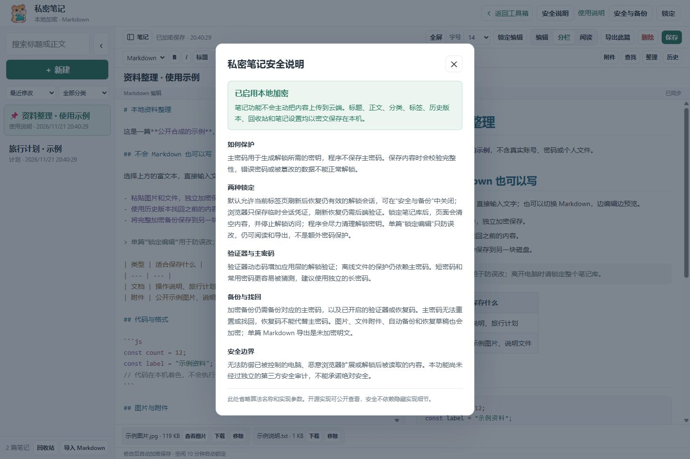

# 私密笔记

[文档目录](README.md) · [安全说明](safety.md)

在本机保存文档、资料和密码，支持富文本、Markdown、图片和文件附件。内容以主密码加密，不向共享访客开放；Windows、Linux、macOS 使用同一种完整备份格式，不需要额外安装编辑器。

[查看手机布局截图](images/private-notes-mobile.png)

## 第一次使用

1. 从工具箱左侧进入“私密笔记”，设置主密码。密码不能为空，不强制长度或字符组合；建议使用独立的长密码。眼睛按钮可以显示或隐藏当前密码框。
2. 首次初始化会保留一篇“使用示例 · 仓鼠笔记”，介绍编辑、附件和备份。它可以编辑、删除；删除后不会反复生成。已有笔记库首次升级时也会补入一次，容量已满时跳过。
3. 点击“新建”，输入名称和正文。默认富文本，可用按钮设置加粗、标题、列表、引用、代码和表格。需要时切换 Markdown；切换本身不会重写正文，富文本修改后会规范化 Markdown 的格式。
4. 修改后约 1 秒自动保存，也可点击保存或按 Ctrl/⌘+S。“已加密保存”旁显示最后成功保存的时分秒，悬停可查看完整日期；保存失败时保留上次成功的时间。确认“已加密保存”后再关闭。右上角“返回工具箱”会先保存草稿，保存失败时留在当前页面。
5. 使用完点击右上角“锁定”。默认空闲 10 分钟自动锁定；刷新当前标签页可恢复仍有效的解锁会话，手动锁定、超时或重启工具箱后需重新验证。

[查看锁定后的解锁界面](images/private-notes-lock.png)。

示例：新建“旅行资料”，输入文字并粘贴一张行程截图；截图会变成加密图片附件。修改正文后，可在“历史”中找旧版本；删除笔记后，可从左侧底部“回收站”找回。

## 编辑和整理

- **编辑、分栏、阅读**：分栏同时显示编辑和实时预览；宽屏左右排列，窄屏上下排列。中间分隔条可拖动，支持方向键微调、双击均分，横向和纵向比例分别记忆。
- **同步滚动与配色**：分栏时滚动编辑区，预览按对应段落跟随；支持富文本和 Markdown、自动换行和窄屏。标题、强调、引用、链接、代码分色显示，常见代码关键字、字符串和数字使用离线基础着色。大于约 20 万字符的 Markdown 正文保留普通文本编辑，避免着色拖慢输入。
- **全屏与侧栏**：工具栏“笔记”按钮可收起/展开左侧列表，电脑端会记住折叠状态；手机列表中也有收起按钮。点击“全屏”隐藏页头并扩大工作区，可再次点击或按 Esc 退出；浏览器不支持系统全屏时使用页面专注模式。锁定笔记库会退出全屏。
- **字号**：默认 14px，可选 10–40px，编辑和预览同步调整，设置随加密笔记库保存。
- **整理**：设置分类、标签和置顶。分类可直接输入，标签用逗号分隔，最多 12 个、每个 30 字；置顶笔记优先显示。
- **搜索和排序**：搜索标题、正文、分类和标签，支持最近修改、最近创建和名称排序；长列表每次只渲染 100 篇，搜索会覆盖整个笔记库。
- **查找正文**：按 Ctrl/⌘+F 或点击“查找”，输入内容后定位下一个匹配。
- **记忆**：编辑器类型、视图、排序、分类和编辑区阅读位置随笔记库加密保存。源码区光标和滚动、富文本区滚动会在切换笔记时记忆；沙箱预览区跟随编辑区定位。

富文本支持常用文字排版和普通表格，不是完整的 Notion 数据库编辑器。切换到富文本不会执行原始 HTML、脚本或加载外链图片。外部链接只作为文字保存；图片附件使用本机解密后的预览。

### 文档排版

预览和富文本编辑区共用一套文档样式：宽屏限制阅读行宽，中文段落使用较宽松的行距，标题按层级区分；表格提供表头、边框和交替底色，引用块与代码块使用浅色背景。超宽表格和长代码在各自区域内滚动，图片随内容宽度缩放，10–40px 字号设置继续生效。

排版参考 [Typora 官方主题文档](https://theme.typora.io/doc/Write-Custom-Theme/) 的文档呈现方式，使用工具箱自己的样式，不需要安装 Typora。

[查看手机阅读与编辑布局](images/private-notes-mobile.png)

## 刷新与解锁状态

“安全与备份 → 刷新后保持解锁（当前标签页）”默认开启。首次输入主密码（及已启用的验证器）解锁后，当前标签页刷新可继续使用，并恢复原来的笔记；每次恢复都由后端验证会话是否仍有效。

浏览器只在 `sessionStorage` 保存临时会话凭证和笔记 ID，不保存主密码、解密密钥、标题或正文。手动锁定、空闲超时、重启工具箱或笔记库被其他实例改密后，旧会话不能恢复。新开页面不会直接采用复制来的凭证；关闭此选项后，刷新或离开页面立即恢复原来的锁定行为。

关闭标签页会结束该标签页的临时存储，但后台密钥仍按所设的空闲时长清理；选择“不自动锁定”时会保留到手动锁定或退出工具箱。浏览器也可能恢复关闭的标签页和会话，因此离开电脑前请主动点击“锁定”。该开关是当前浏览器的偏好，不随加密备份迁移。

## 图片与文件附件

在正文编辑区可 **Ctrl/⌘+V 粘贴图片或文件、拖入文件，或点击“附件”选择文件**。部分浏览器和系统剪贴板不能提供文件对象时，可改用拖入或附件选择。仅粘贴普通文字或网页格式时，仍按编辑器的文字粘贴处理。

- 图片和文件独立加密保存，正文保留附件引用，避免每次打字重写大文件。
- 常见图片显示在正文中；较大图片按需加载。页面底部提供查看图片、下载和移除入口，图片解密缓存有数量和体积上限。
- 每个附件最多 **25 MB**，每篇最多 **100 个**，每次最多添加 **20 个**；整个笔记库的附件总量最多 **448 MB、2000 个**。
- 附件下载是**解密后的原文件**，请妥善保管。文件不会自动交给系统打开；SVG 等可能包含活动内容的类型不作为正文图片加载。
- 移除附件后，历史版本和已有备份中的副本仍会保留。彻底删除笔记并清除相关历史后，不再被当前笔记库引用的加密附件文件会清理；独立备份不会被修改。

图片预览可能缩小尺寸以提高显示速度；下载的原文件不会被重新压缩。

## 保存失败与加密草稿

正常保存失败时，编辑框保留当前内容，并显示错误。修改后立即重新选择当前笔记，会读取刚保存的最新版本。

解锁后，浏览器使用从当前笔记库密钥独立派生的草稿密钥，给草稿加密；加密副本尽力保存在浏览器和本机数据目录。自动锁定或会话失效时，先尝试保留加密草稿，再清空页面；重新解锁后，可将未保存草稿恢复为一篇新笔记，避免覆盖已有内容。

程序不会把草稿密钥、主密码或明文草稿写入浏览器持久存储。换端口时，本机数据目录中的草稿可继续恢复；如果服务已中断，只有浏览器副本写入成功，则需要在原浏览器和原访问地址解锁。关闭时仍有未保存内容会触发浏览器提示。

这不是零丢失保证：浏览器清理、存储禁用、设备故障、强制关闭或加密尚未完成时中断，仍可能丢失未保存改动。请以“已加密保存”为准。

## 加密回收站和历史版本

删除笔记会先进入加密回收站，可恢复或彻底删除；编辑锁定的笔记不能删除。回收站最多保留 **200 篇、8 MB**，超过时清理最早项目。

正文或名称修改前会保留历史快照，自动快照每分钟最多一份；也可在“历史”中点击“保存当前快照”。每篇最多 **20 份**，全库最多 **200 份、8 MB**，超过时清理最早快照。查看历史不会改动当前正文；恢复时会先把当前内容保存为快照，并增加修订号。

[查看历史版本界面](images/private-notes-history.png)。

历史版本、回收站、分类、标签和编辑锁都包含在加密备份中。彻底删除只影响当前笔记库，不会删除之前导出的备份。

## 两种锁定

**锁定笔记库**需要主密码重新解锁，并会清空当前页面、尽力清理解锁密钥与解密缓存。

**锁定编辑**只防止误改。单篇锁定后仍可阅读、调整字号、查看历史和导出；标题、正文、附件更改和删除会被前后端拦截。点击“解锁编辑”即可继续，不需要再次输入主密码，锁状态随加密笔记库保存。

在“安全与备份”中可设置空闲自动锁定：常用时长、自定义 1–10080 分钟，或不自动锁定。设置保存后重启仍保留；选择不自动锁定时，请离开前手动锁定。

## 自动加密备份和迁移

自动备份默认开启：**间隔 30 分钟、保留 10 份**，默认位于数据目录下 `private-notes/auto-backups`。可以选择其他备份目录、修改间隔和保留数量，也可“立即备份”。页面显示实际目录、最近成功时间、份数和失败信息。

第一次保存会产生备份；后续改动合并为待备份快照，运行期间按间隔写入最新内容，锁定时也会补存待备份内容。程序关闭后不会继续备份。自动备份失败不会撤销已成功的笔记保存，但会提示；请检查磁盘和目录权限。建议把备份目录设置到另一块磁盘。

- **手动导出**：“安全与备份 → 导出加密备份”，生成 `.hamster-notes`，包含笔记、历史、回收站和全部仍引用的附件。
- **跨电脑迁移**：在另一台电脑导入完整备份，输入该备份的主密码；开启验证器时，还需动态码或恢复码。完整备份最多 512 MB。
- **导入已有笔记库**：先解锁当前笔记，再确认替换。会先保存 `before-import.hamster-notes`，包含当前附件；导入不合并内容。
- **当前文件损坏**：未解锁页面会显示恢复入口。先验证备份密码、验证码和附件完整性，再恢复；损坏文件以单独名称保留。密码错误、附件缺失或校验失败时不替换原笔记。
- **修改主密码**：当前笔记和附件继续可用，之后使用新密码。旧备份仍需要旧密码，旧备份中的验证器和恢复码状态也保持备份时的样子。

默认数据目录为 Windows 的 `%APPDATA%/hamster-toolbox`；Linux/macOS 以启动时显示的用户配置目录为准，`-data` 可指定其他位置。`private-notes/vault.json` 保存加密正文与附件索引，`private-notes/attachments` 保存加密附件；**有附件后不能只复制 vault.json 作为完整备份**。优先使用导出完整加密备份，也可在退出程序后备份整个 `private-notes` 目录。

程序、安装目录、源码仓库和发布包不包含个人笔记；正常升级会保留用户数据。重装或清理系统前仍建议导出备份，并验证能恢复。

## 验证器和安全边界

“安全与备份 → 开启验证器”支持常见 TOTP 验证器，二维码本地生成。开启后需要主密码加动态码，或主密码加一条未使用的恢复码。8 条恢复码仅在生成时显示；修改主密码、关闭验证器和重新生成恢复码需要再次验证身份。

**主密码无法重置或找回。恢复码只能代替验证器，不能代替主密码。** 不要把唯一的主密码和恢复码只保存在当前笔记库中。

验证器是应用层解锁验证，不构成独立的离线加密因素。拿到文件并知道主密码的人可以绕过程序的验证器检查。无法防御已被控制的电脑、恶意浏览器扩展或解锁后被读取的内容，当前没有独立第三方安全审计，不能承诺绝对安全。

页面“安全说明”介绍保护范围，不展示算法名称和参数。

技术上，主密码使用随机盐的 Argon2id 派生密钥，笔记采用 AES-256-GCM，版本和派生参数参加完整性认证，每次写入使用新 nonce。附件使用独立随机数据密钥，该密钥仅保存在加密笔记库中；修改主密码只重新保护数据密钥，不重写所有附件。草稿使用从解锁密钥独立派生的密钥，不另设较弱的密码派生流程。相关实现公开可审查，安全不依赖隐藏实现。

预览使用沙箱和内容安全策略；富文本编辑器采用受限文档结构，不加载 CDN、外链图片或执行笔记中的 HTML。完整备份包含已加密的文件，不包含主密码或解密后的附件。

## Markdown 导入导出和容量

“导入 Markdown”每次 1–200 个 `.md` / `.markdown` 文件，每篇最多 1 MB、合计最多 10 MB；导入为新笔记，不覆盖同名笔记。从 Notion 迁移时，可先导出 Markdown、解压后再导入；目前不自动导入 Notion 数据库、附件目录或页面层级。

单篇导出是**明文 Markdown**，不打包附件，仅保留附件引用；导出前会提醒确认。迁移整个笔记库请使用完整加密备份。

每篇标题最多 200 字，正文最多 1 MB；最多 2000 篇，当前正文与元数据合计最多 10 MB，含回收站和历史的笔记库明文序列化总量最多 32 MB。附件不计入正文限制，单独受附件容量约束。文件格式有版本标识，不支持的版本会拒绝导入。
