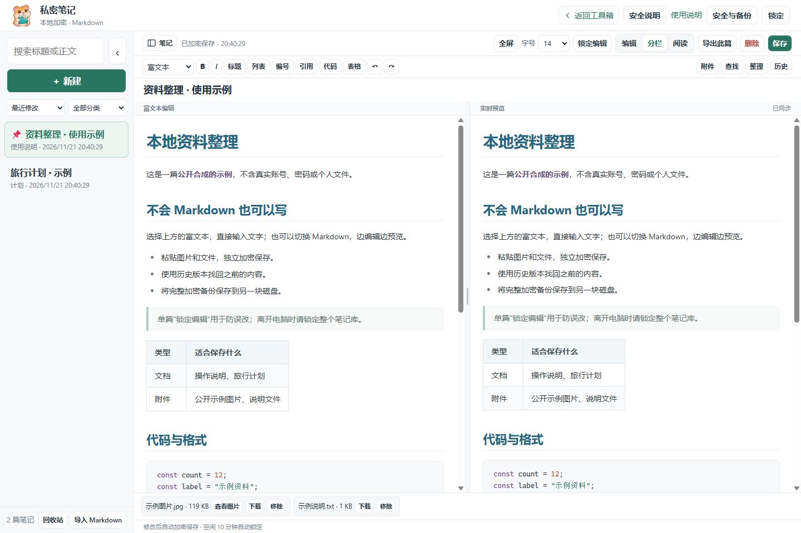

# 仓鼠工具箱 v0.2.3 发布说明

[文档目录](../README.md) · [版本变更](../../CHANGELOG.md)

本版新增本地加密笔记，完善工具分组、资源管理器与解压体验。Windows x64 安装包、完整便携包、程序更新包及 SHA256 见 [v0.2.3 发布页](https://github.com/sizhaiwu/hamster-toolbox/releases/tag/v0.2.3)。

## 本版重点

### 私密笔记

新增本地加密笔记，适合保存说明、文档、图片与文件。默认富文本，不会 Markdown 也能使用；支持可拖动分栏、同步滚动、文本配色、全屏、侧栏折叠、字号和阅读位置记忆。

- 主密码加密，可选验证器动态码与一次性恢复码；主密码无法找回。
- 分类、标签、置顶、搜索、正文查找、历史版本、加密回收站和防误改的单篇编辑锁。
- 图片和文件粘贴、拖入或选择后独立加密；自动保存显示最后成功时间，失败时保留上次成功状态。
- 自动加密备份、含附件的完整备份与跨电脑迁移。每次升级前建议导出完整备份。
- 默认刷新当前标签页可恢复有效解锁会话；手动锁定、超时或重启工具箱后需要重新验证，可关闭刷新恢复。

[完整操作、容量和安全边界](../private-notes.md)。笔记只在本机管理页面使用，不开放给资源共享访客，也不提供笔记 CLI。

### 工具导航与文件操作

- 工具和独立工作空间分组显示，各组可折叠并记忆。
- 资源管理器支持 F2 改名、Delete 删除、方向键选择及 Backspace 返回等常用快捷键，返回目录保留有效选择。
- 本机压缩包右键可直接进入单包解压预览；扩展复合 TAR 和常见归档扫描。
- 修复目录时间戳不变时，快速改名后缓存未更新、后续移动失败的问题。
- 通用设置支持点击弹窗外部关闭；原有任务提醒、播放与缓存设置保留。

### 平台支持

完整安装包、便携包、托盘和开机自启仍面向 Windows x64。Linux/macOS 通过源码构建并安装本机组件；笔记使用同一份加密备份格式。六种目标架构编译通过不等于六种真机全部验证，详见 [平台说明](../platforms.md)。

## 下载与升级

普通 Windows 用户选择 `*-setup.exe`，便携用户选择完整 ZIP；`*-update.zip` 不含组件，不能单独运行。参见 [安装与更新](../installation.md)。

1. 等待任务结束、保存笔记，并导出包含附件的完整加密备份；从托盘或控制台退出旧工具箱。
2. 备份旧程序实际使用的数据目录。当前 Windows 默认是 `%APPDATA%\hamster-toolbox`，自定义 `-data` 以实际路径为准。
3. 早期测试版使用 `%APPDATA%\media-toolbox` 时，新版不会自动迁移。退出服务后可将旧目录完整复制到新的数据目录，或继续使用 `-data` 指定原位置；不要直接合并两份不同的数据目录。
4. 安装新版或将完整便携包解压到新目录。不要混用不同版本的 DLL；组件清单不匹配时使用完整包。
5. 启动后核对版本、用户数据、笔记附件和共享设置。升级前已运行的任务不会自动接续；旧版本不一定能读取新版笔记格式，回退应使用升级前备份。

## 使用边界

- 笔记主密码和动态码不是云账户；忘记主密码无法重置。动态码是应用层验证，不是独立的离线加密因素。
- Markdown 单篇导出和附件下载是明文；迁移整个笔记库应使用完整加密备份。有附件时不能只复制 `vault.json`。
- 刷新恢复只保存临时会话凭证。关闭标签页后，后台仍按空闲设置清理解锁状态；离开电脑前请手动锁定。
- 当前没有独立第三方密码学安全审计；无法防御已被控制的电脑和恶意浏览器扩展。程序与安装器目前未签名。
