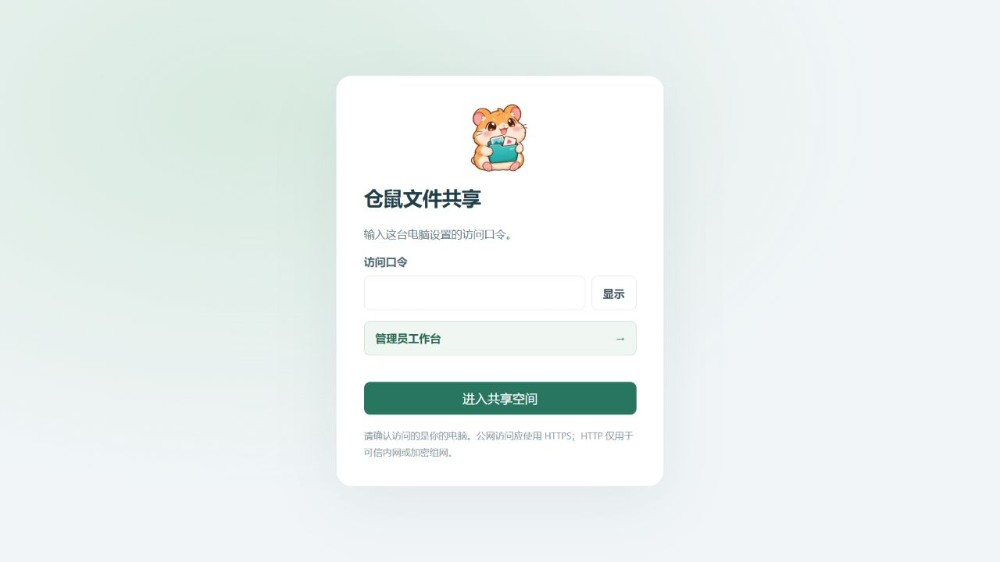
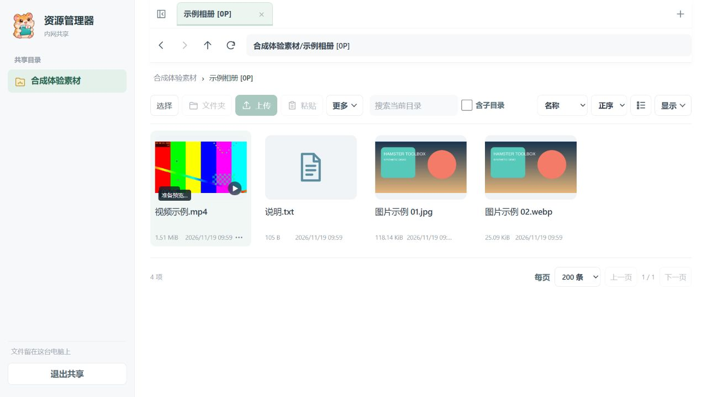

# 手机流量与远程访问

[文档目录](README.md)

[返回首页](../README.md) · [资源管理器与共享](file-browser.md)

本功能适配现有组网或穿透服务，不代替它们创建隧道。仅转发资源共享端口，默认 `18788`；工具箱管理页使用的本机端口不应对外开放。共享口令、目录权限及路径保护始终生效。

第一次配置可先读 **[不同网络访问：新手教程](remote-access-quickstart.md)**，包含 xEdge 添加电脑/手机终端、ZeroTier 创建网络与授权、手机切换流量验证和常见问题。两种组网只需选一种；本页继续说明其他产品通用的接入与 HTTPS 代理设置。

## 访客访问示例

**1. 打开共享地址，输入访问口令。** 口令由运行工具箱的电脑设置；正确后点击“进入共享空间”，无需手动刷新。不要使用带 `session` 的本机管理链接。以下截图来自独立演示共享，未展示口令或实际网络地址。

**2. 选择共享目录，浏览图片、视频和文件。** 电脑单击选中、双击打开；手机也可选中后点击“打开”。视频封面和时长按需加载，文件可预览或下载。本例使用只读权限，因此上传、新建等修改按钮不可用；需要修改时由主机逐目录开启权限。访客看不到主机的批处理、通用设置和共享管理入口。

截图只使用仓库合成素材，不包含私人资源或路径。网络接通后，内网、加密组网及 HTTPS 穿透均使用这一套访客页面；手机和平板会按屏幕宽度调整布局。

## 按连接方式设置

| 使用方式 | 工具箱设置 | 手机怎么访问 |
| --- | --- | --- |
| 加密组网，电脑和手机都已连接 | 开启“允许虚拟组网访问”，保存；无需填外网地址 | 使用电脑的组网 IPv4，例如 `http://100.64.0.10:18788/`，再输入共享口令 |
| TCP 端口映射，本机隧道进程连接工具箱 | 指向 `127.0.0.1:18788`。保留默认本机代理信任；HTTPS 入口填写外网地址 | 使用穿透服务提供的地址。公网浏览器访问应配置 HTTPS |
| 公网映射或其他设备转发 | 若来源为 `100.64.0.0/10`，开启组网访问；HTTPS 代理另填实际转发设备的 IP | 使用穿透服务提供的公网地址，保留共享口令 |
| HTTPS 反向代理 | 在“通过公网域名访问”填写完整 HTTPS 地址；代理在本机时，可信代理留空；在其他设备时填其实际 IP | 例如 `https://files.example.com/`；已有代理身份认证仍可保留 |

表格是配置模式说明，不能保证所有产品、套餐和版本的默认配置都相同。以实际转发来源、协议和代理头设置为准。

共享地址区会显示本机可用的内网地址，以及启用后的 `100.64.0.0/10` 组网地址。此网段本身不代表设备已获授权，仍需正确的共享口令。电脑、工具箱和穿透/组网客户端均须保持运行。

## HTTPS 域名和可信代理

打开本机“通用设置 → 共享与远程 → 配置共享与远程访问 → 通过公网域名访问”：

- **外网访问地址**：填写浏览器实际使用的 HTTPS 地址，例如 `https://files.example.com` 或 `https://files.example.com:9443`。留空表示不启用 HTTPS 代理适配。目前支持一个域名入口的根路径，不支持 `/toolbox/` 子路径挂载；不要填写登录口令、Token 或带查询参数的地址。
- **可信代理 IP**：穿透进程就在运行工具箱的电脑时留空，默认信任本机回环地址。其他设备代理时填它连接工具箱所用的源 IP，例如 `192.168.1.10` 或 `100.64.0.10`。多个用逗号分隔，也支持 CIDR。只填写实际代理地址，不要为了连接成功而信任所有来源。
- **保存并应用**：以上设置随目录、口令和端口一起保存；启用共享后随工具箱启动恢复。填写地址不会自动申请域名、证书、启动穿透客户端或修改系统防火墙。

代理保留外部 `Host` 或改写成本机 `Host` 都可使用；浏览器 POST 的 `Origin` 必须与已配置的 HTTPS 地址一致，且连接来自可信代理。HTTPS 登录会使用 `Secure`、`HttpOnly`、`SameSite=Strict` Cookie。来源校验不会因为代理开启而取消，未配置的 HTTPS 来源不会获得允许。

本机普通 HTTP 访问仍可用。公网 HTTP 映射没有浏览器到入口的 TLS 保护，应改为 HTTPS；加密组网内 HTTP 的传输保护由组网提供。

## 代理配置注意事项

- 代理应覆盖或正确追加 `X-Forwarded-For`，并传递 `X-Forwarded-Host`、`X-Forwarded-Proto`。工具箱仅从可信代理读取这些信息，登录限流从代理链右侧查找首个非可信来源，避免直接相信客户端可伪造的最左值。代理无法提供可靠客户端 IP 时，多个用户可能共享一组登录限额。
- 视频播放需要转发 `Range` 请求和 `206` 响应；关闭会破坏流式传输的改写或缓存规则。上传大小、超时、总流量还受到穿透服务和代理自身配置限制，工具箱的单文件上限不会绕过这些限制。
- 兼容播放还需要允许持续的分块响应，并关闭代理对该响应的完整缓冲。服务会发送 `X-Accel-Buffering: no`；兼容模式通过页面中的“全片进度”滑条跳转。不要让代理覆盖浏览器的 `Origin`、`Sec-Fetch-Site`，媒体处理入口仍要求同源访问。
- 通过 HTTPS 页面播放和下载的地址保持同源，不会跳回电脑的 `127.0.0.1` 或内网 IP。未认证用户只能打开登录页和静态脚本，不能浏览目录、读取媒体或使用文件操作。
- 目录默认只读；需要上传、移动、改名、删除时，再明确开启对应目录的“允许修改”。公网代理可在工具箱口令之外叠加自己的访问认证。
- 如果显示来源拦截，检查组网开关与真实代理 IP；如果页面打开但登录/操作报“同源POST请求”，检查 HTTPS 入口是否与配置完全一致（包含端口），以及是否通过所信任的代理。

技术参考：[反向代理头处理](https://pkg.go.dev/net/http/httputil#ProxyRequest.SetXForwarded)。
