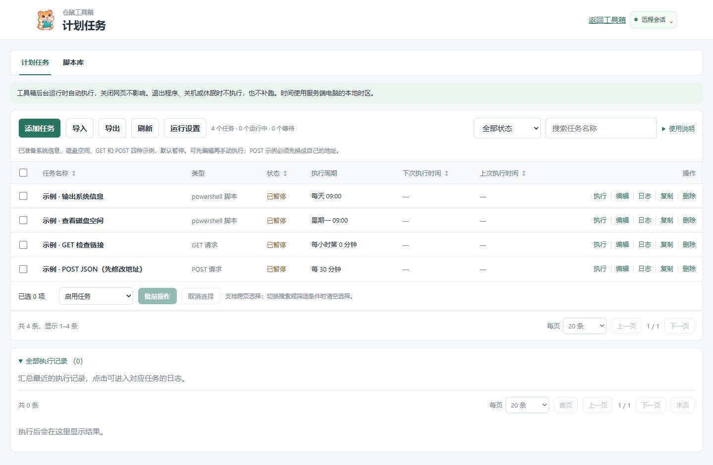

# 计划任务

入口：工具箱左侧“计划任务”。手机或其他电脑先通过 `/admin/` 登录完整远程工作台，再进入同一入口；支持新建、编辑、执行、启停、日志、脚本库、批量操作及导入导出，操作在服务端电脑执行。任务列表采用紧凑表格，显示名称、类型、状态、执行周期和上次／下次执行时间；支持名称搜索、状态筛选、按列排序和每页 20 / 50 / 100 条（自动记忆）。手机端自动改为纵向条目。点击状态可启停；“复制”会把完整配置载入新任务，副本默认暂停，保存后才创建。这是工具箱内置调度器，不向 Windows 任务计划程序或系统 crontab 写入任务；Windows、Linux、macOS 使用同一套规则。




## 常用脚本库

页面顶部切换到“脚本库”，可按系统检查、文件与资源、网络请求、工具箱自动化筛选，也可搜索用途。点击“使用模板”，填写路径、大小、天数或请求内容，再点击“生成任务并检查”。工具箱会按当前系统生成 PowerShell 或 sh 脚本，或者直接生成内置 GET / POST 任务。

模板只生成任务草稿，**不会直接保存或执行**；会进入现有编辑弹窗，所有模板默认暂停。确认脚本与周期后保存，再手动测试，最后启用。参数和脚本不存入浏览器本地缓存。路径中的空格、中文、引号等会按对应解释器转义，不能把参数直接当作脚本执行。

| 模板 | 作用 |
| --- | --- |
| 查看系统信息 | 输出时间、系统版本和工作目录 |
| 检查磁盘空间 | 查看磁盘使用量与剩余空间，不自动清理 |
| 列出目录文件 | 递归列出普通文件，日志保留末尾 64 KB |
| 查找大文件 | 按 MB 阈值生成报告，不删除 |
| 查找长期未修改的文件 | 按天数生成报告，不删除；不同系统日期边界可能相差一天 |
| 计算文件 SHA256 | 生成完整校验值，不修改原文件 |
| 备份本地文件夹 | 在独立目录内建立带时间编号的新副本，不覆盖原件、不自动删旧备份 |
| 定时访问链接（GET） | 调用自己的服务检查／更新接口 |
| 发送 JSON / Webhook（POST） | 向自己的接口发送 JSON，需核对远端操作 |
| 定时更新目录统计名称 | 复用工具箱 CLI；执行模式会改子目录名称 |
| 定时压缩 JPG 图片 | 默认质量 75，仅 JPG/JPEG 类格式，结果写到独立目录 |
| 定时压缩视频 | 默认省空间模式、自动加速，保留工具箱原有阈值和保护逻辑 |
| 定时生成视频预览图 | 默认 5×5 拼图，宽度 1024，写到独立目录 |

工具箱自动化模板默认 **只扫描预览**；需要实际处理时，在生成前改成“扫描并执行”，或随后检查脚本。原有 CLI 的目录保护、依赖检查、冲突与输出规则仍然适用；重跑不代表程序自动识别内容是否已处理。定时任务不在普通文件任务历史中另外生成记录，结果见当前任务日志。

资源目录和输出目录必须已经存在，且不能相同或互相包含；避免备份或压缩把自己的结果重新扫入。可点击“选择目录／文件”浏览服务端磁盘并选择现有路径；支持输入完整路径、返回上一级和名称筛选。输出目录可先在资源管理器中创建。每次最多显示 500 项，目录较大时请筛选名称。文件夹备份可能占用较多空间，旧备份需要自行管理；复制失败可能留下不完整的新副本，不能当作成功备份。复制不是数据库一致性快照，也不替代加密笔记自己的加密备份。

Windows 只读检查和复制使用系统 PowerShell / .NET；Linux/macOS 使用系统 sh、find、df、cp 与校验命令，极简系统可能需要准备对应工具。媒体模板仍需 FFmpeg、ImageMagick 等组件，完整版会自动检测；解释器、权限与依赖问题会在执行日志中报告。

## 初始示例

首次启动计划任务会添加四个暂停的示例：输出系统信息、查看磁盘空间、GET 检查链接、POST JSON。Windows 自动使用 PowerShell，Linux/macOS 使用 sh。脚本示例只查询信息，不清理或修改文件。

GET 示例使用 `https://example.com/`，POST 使用不会指向真实服务的 `https://example.invalid/api`，需要先换成自己的接口。所有示例默认暂停，不会自行执行脚本或发起网络请求；可以编辑、立即执行或删除。

初始化只执行一次：保留已有任务，删除示例后重启不会再次添加，删空列表也不会自动恢复。

## 快速开始

1. 点击“添加任务”，填写名称。
2. 选择“访问链接”或“执行脚本”，配置执行内容。
3. 选择周期、超时时间，保存。可先取消“保存后启用”，再点击“立即执行”测试。
4. 在任务操作中点击“日志”，单独查看此任务的执行记录和输出；底部默认展开“全部执行记录”，统一查看各任务记录。暂停不终止已开始的任务，需要停止时点“停止”。删除、编辑前也需要停止当前执行。

### GET / POST 示例

每天 09:00 检查服务：选择 GET，填写 `https://example.com/health`，周期“每天”，时间 `09:00`。每次运行会记录 HTTP 状态和响应内容；默认 2xx 为成功；可展开“成功条件与失败重试”，指定一个预期状态码或响应必须包含的文字。两项都填写时需同时满足。内容检查限响应前 1 MB。

每 30 分钟提交 JSON：选择 POST，地址填写自己的接口，展开请求头与请求体。

请求头：

```json
{"Content-Type":"application/json"}
```

请求体：

```json
{"source":"hamster-toolbox","action":"check"}
```

GET 不发送请求体；HTTPS 验证证书，使用系统代理环境，不提供忽略证书错误开关。失败重试默认关闭，可设置 1～3 次、间隔 1～300 秒；超时包含全部请求和等待时间。POST 需另行勾选允许重试，确认接口允许重复提交后再使用。脚本不自动重试。

### 脚本示例

Windows 选择 PowerShell，脚本填写：

```powershell
Get-Date
Write-Output '计划任务执行成功'
```

Linux / macOS 选择 sh：

```sh
date
printf '%s\n' '计划任务执行成功'
```

也可以使用 CMD，或调用已有工具箱 CLI。第三方程序使用绝对路径；填写工作目录可控制相对路径。未填写时使用工具箱用户数据目录。解释器和被调用程序需在本机可用，Windows 的 sh/bash 需自行安装。脚本为非交互模式，不能等待输入。

PowerShell 为本次进程设置执行策略和 UTF-8 输出，默认停止错误，不改变系统执行策略。脚本是否成功由退出码判断；调用外部程序时应自行检查退出码，必要时 `exit $LASTEXITCODE`。CMD 中文输出可先执行 `chcp 65001 >nul`。

## 批量操作与导入导出

勾选任务左侧复选框，可跨页选择；表头复选框只全选当前页。底部支持批量启用、暂停、执行、停止、导出和删除，逐项报告结果。切换搜索或筛选时清空选择，避免误处理隐藏任务。

批量执行按“运行设置”中的并发数运行（默认 4，可设为 1～8），超额任务按提交顺序排队。同一任务不会重复运行或重复入队；提交结果区分已启动、已排队和失败，失败项保留勾选方便检查。暂停会取消尚未开始的等待并关闭后续调度；停止用于取消等待或终止当前执行。等待队列只存在于本次服务运行期间，重启后不补跑。运行中的任务停止后才可编辑或删除；等待中的任务取消等待后再编辑。降低并发不会打断当前执行。

执行、删除及对应批量操作使用站内确认弹窗，列明任务名称与数量，默认聚焦取消；取消或按 Esc 不会发送请求。配置保存失败时回滚启停和删除结果。

### 导入

顶部“导入”选择 UTF-8 JSON（最多 16 MB、100 个任务），先检查预览，再确认。支持工具箱完整格式和宝塔导出的 JSON 数组，也接受宝塔单条 JSON 对象。支持同名跳过或自动改名，**不覆盖已有任务**。导入完成会单独弹出结果，显示新增与跳过数量、任务名称和原因；即使关闭了导入窗口仍会提示。成功后清空搜索和状态筛选并刷新列表。连接中断而无法确认结果时，会提示先核对列表，避免重复提交。无效或不支持的条目逐项说明，其他有效任务仍可导入；新 ID 自动生成，全部暂停，不导入旧日志、执行状态或运行中的进程。

支持以下宝塔基础任务字段，参考[宝塔公开导入导出格式](https://github.com/aaPanel/BaoTa/blob/main/class/crontab.py)及[接口说明](https://docs.bt.cn/api/crontab/actions/)。不同面板版本可能存在差异，导入后请核对脚本、路径和执行周期，再启用任务。

- Shell（`toShell`）：保留脚本文本并使用 bash；不会自动转换成 Windows PowerShell / CMD。系统命令、程序、路径和权限需要自行核对。
- GET（`toUrl`）：保留 URL 和 User-Agent。
- POST（`to_post`）：将 `post_param` 中的 `paramName` / `paramValue` 转为 JSON 对象，保留 JSON 值类型。
- 周期：每天、N 天、每小时、N 小时、N 分钟、每星期、每月及 `second` 字段保存的秒级任务；兼容数字或数字字符串，星期日 7 映射为 0。
- 网站／数据库备份等宝塔专属任务、特殊时间段和响应关键字断言不自动转换，显示原因。分类、告警、备份参数等宝塔专用元数据不迁移。

可直接用[合成宝塔 JSON 示例](../samples/schedules/baota-example.json)体验预览和导入，不涉及真实服务器资源。

### 导出

可导出全部任务或已选任务，导出文件包含完整脚本和请求配置，可能含密码／Token，请妥善保管。文件不含日志。

| 格式 | 用途与限制 |
| --- | --- |
| 工具箱完整格式 | 推荐用于工具箱之间迁移。保留全部配置；在目标工具箱导入时重新生成 ID 并暂停。 |
| 宝塔基础兼容 JSON | 输出宝塔数组字段结构，支持基本周期、bash/sh、GET 和 JSON 对象 POST。不支持 PowerShell / CMD、自定义 Cron、旧固定间隔、工作目录或额外认证请求头等无法直接映射的配置，会明确跳过。 |

宝塔格式下载前会显示差异并再次确认：**宝塔部分版本的导入实现会直接启用任务，即使 JSON 中写入暂停状态**。迁入目标面板时应安排好执行时间并核对启用情况。执行超时、重试、HTTP 成功条件和解释器行为由宝塔控制，不能声称执行语义完全一致；目标服务器的时区也可能不同。宝塔不同版本的字段或功能可能有差异，遇到不支持条目请保留原文件核对，不自动改写脚本。

## 任务日志

每个任务都有独立的“日志”按钮，默认采用连续终端视图：按服务端时间从早到晚合并多次执行，每次显示时间、状态及输出。顶部显示日志目录和总大小，可选全部、近 7 天、近 30 天或自定义日期（包括结束日期整天）。时间范围按执行开始时间筛选，仅查看尚未清理的记录。合并输出较长时显示末尾约 1 MB，可缩小范围或切换“单次记录”查看单次输出；从全部执行记录点击某次运行会直接进入单次视图。

支持手动刷新、复制日志、直接执行任务。自动刷新可开关并记忆，开启后约每 4 秒刷新；浏览旧内容时保持滚动位置，位于末尾时跟随新输出。单次执行输出保留末尾 64 KB，超过上限时标明截断。服务约每秒保存变化的实时输出，意外退出仍可能丢失最后尚未保存的片段。不同任务的输出互不混入，切换、关闭和清空后不会被迟到请求覆盖。

“清空日志”使用站内确认框，清空当前任务**全部已结束的执行记录及对应日志文件，不受时间筛选限制，无法恢复**；不修改任务配置、周期和其他任务的日志，保留正在执行的记录及输出。日志被其他程序占用时会报告未能删除的文件数量，服务重启时再次清理残留文件。

计划任务的全部弹窗遵循通用设置“点击遮罩关闭弹窗”（默认关闭）。开启后点击窗口外部可关闭；确认弹窗按取消处理，拖动或从窗口内部拖到外部不会误关。关闭查看窗口不停止后台任务，已提交的操作仍会执行。

底部“全部执行记录”默认展开，可手动收起，汇总各任务保留范围内的记录。默认每页 20 条，可切换为 50 或 100 条并记忆，与上方任务列表的分页独立；支持首页、上一页、下一页和末页，自动刷新保留当前页，清理记录后自动调整到有效页。分页只影响显示，不会删除记录。顶部“运行设置”可设置每任务保留 5～100 次（默认 20），减少数量会清理更早记录及日志文件；高频任务不会挤掉低频任务的历史。已删除任务合计保留最近 100 次记录。点击任一条会打开对应任务日志并选中该次执行；任务删除后，在记录被自动淘汰前仍可从总记录查看。

## 时间规则

周期选项采用[宝塔常见周期的填写方式](https://docs.bt.cn/ai-ops/mcp/tools-reference/)：

| 周期 | 填写内容 | 时间含义 |
| --- | --- | --- |
| 每天 | 小时、分钟 | 每天指定时间 |
| N 天 | 天数、小时、分钟 | 按每月日历日步长，从 1 日开始；N=2 为 1、3、5 日等 |
| 每小时 | 分钟 | 每小时的指定分钟 |
| N 小时 | 小时数、分钟 | 每天从 0 点起按步长；N=2 为 0、2、4 点等 |
| N 分钟 | 分钟数 | 每小时从 0 分钟起按步长；N=30 为 0、30 分钟 |
| 每星期 | 星期、小时、分钟 | 每周指定时间 |
| 每月 | 日期、小时、分钟 | 没有所选日期的月份跳过 |
| N 秒 | 秒数（1～59） | 服务运行时按秒间隔触发，未完成不重叠 |
| 自定义 Cron | 五项表达式 | `分 时 日 月 周` |

执行周期下方会实时显示文字说明和接下来 5 次具体执行时间，包含日期、星期、时分秒及服务端时区。预览与实际执行共用调度算法；修改周期、数字或 Cron 后自动重新计算，参数有误时显示原因，不会保存或运行任务。示例按当前时刻假设保存并启用，暂停的任务不会因预览而执行。

N 天、N 小时、N 分钟属于日历步长，并非从保存时刻连续累加时长。旧任务的固定间隔会保留原方式，编辑时显示“原有固定间隔”；不会静默改变执行时间。

自定义 Cron 支持 `*`、数字、逗号、范围和 `/` 步长，周日为 0 或 7。

| Cron | 含义 |
| --- | --- |
| `*/30 * * * *` | 每半小时 |
| `0 9 * * 1-5` | 周一至周五 09:00 |
| `0 2 1 * *` | 每月 1 日 02:00 |

日和周同时指定时，任一匹配即可运行。保存时校验未来五年内有可执行日期。日历周期计算下一次符合规则的时间，手动执行不会新增一次额外补跑。

## 后台运行与记录

- 工具箱进程必须运行。关闭网页不影响，托盘版可配合通用设置中的开机自启。
- 关机、休眠、工具箱退出期间不会执行，恢复后不补跑遗漏任务；重启中断的执行标记为“中断”，不自动重新执行。
- 同一任务不会重叠运行；并发可设为 1～8，超额排队；与普通工具任务共享 CPU、网络、磁盘等资源。长任务跨越多个周期时不会积压补跑。
- 最多保存 100 个任务；记录按任务独立保留，每次输出保留末尾 64 KB。列表轮询只取摘要，点开记录才读取输出。
- 同一数据目录只允许一个进程管理计划任务；第二实例显示锁定提示，避免重复执行。服务退出后锁由系统释放，无需删除锁文件。
- 计划任务不弹出右下角完成通知，避免批量运行时叠加。导航入口显示运行／等待数量，结果在任务状态和日志中查看。声音遵循通用设置，同一次轮询多个任务完成只响一次；浏览器需有过用户交互才可能播放声音。没有打开页面时仍执行并保留记录，不发送系统通知或邮件。

## 数据与安全

配置保存在工具箱用户数据目录的 `schedules.json`，记录摘要保存在 `schedules-history.json`，输出保存在 `schedule-logs/`。更新程序不会覆盖；退出程序后复制这三项即可连同历史迁移，单独迁移配置也可使用导入导出。原有内联日志会自动迁入独立日志文件。配置含脚本与请求头，日志可能包含请求内容和输出，**未加密**，不要将笔记主密码等敏感内容写入。日志对外分享前需要脱敏。

脚本拥有启动工具箱账户的文件和网络权限，只运行自己理解的内容。管理入口向本机和完整远程工作台管理员开放；普通文件共享访客无权访问。远程使用需要独立管理员登录、同源请求及会话校验，仍遵循共享设置中的 HTTPS／可信 HTTP 规则。单个任务工作目录消失、配置不适用等问题只暂停该任务，列表显示“需处理”及原因，其余任务继续运行，仍可编辑或删除异常任务。配置或日志索引损坏等无法安全解析的情况会停止调度并显示错误，不覆盖原数据。

超时或停止会取消 HTTP 请求、终止脚本进程树；已经发生的文件修改、网络请求和后台脱离的程序无法回滚。强制结束进程、系统断电无法保证有机会执行清理。

## 目录互斥

普通工具任务、终端 CLI 和计划任务调用的 CLI 共用同一操作系统用户的资源互斥记录。相同目录发生读写冲突时会等待，支持取消，工具仍会在执行前重新检查安全与预览状态；不相关目录及兼容的独立媒体输出可以并行。进程退出后系统释放锁，下次会清理失效记录，不需要手动删除锁文件。

自定义脚本无法自动推断文件操作。可在编辑器“目录互斥保护”中声明读取／写入绝对路径（每行一个，每类最多 16 个）；备份模板自动声明源目录读取和备份目录写入。只读与只读不互斥，写入与相关读写互斥。声明保护的脚本调用工具箱 CLI 不会等待自己的锁。互斥只约束遵守此规则的工具箱进程，不阻止其他软件、其他系统用户或自己未声明路径的脚本修改资源。等待资源释放计入任务总超时。
