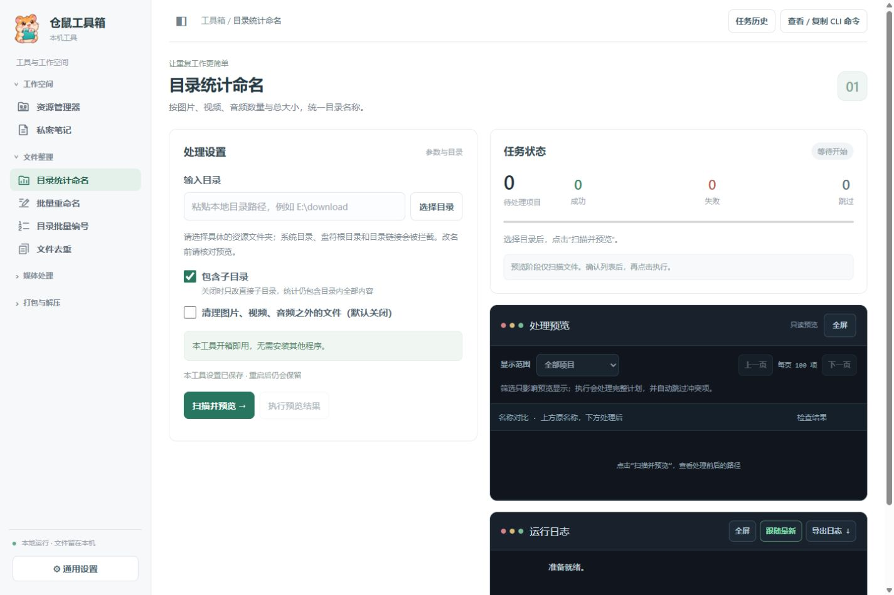

# 使用指南

[文档目录](README.md)

[返回首页](../README.md)

## 开始使用

安装版从快捷方式打开；便携版完整解压后，双击 `hamster-toolbox-desktop.exe`，在浏览器中操作。批处理选择工具和目录后，先“扫描并预览”，再“执行预览结果”；修改参数后需要重新预览。需要控制台或 CLI 时使用 `hamster-toolbox.exe` / `start-toolbox.cmd`。

关闭浏览器页面后程序仍在运行：托盘版通过托盘菜单退出，控制台版关闭控制台退出。文件处理与笔记不依赖外网；版本检查和组件下载需要网络。

启动终端会集中显示服务状态、浏览器打开情况、内网共享状态、本机访问链接和设置与任务记录目录。链接包含本次启动的访问凭据，请勿分享整张启动截图；其他设备应使用资源管理器中提供的共享地址。终端支持时自动显示彩色状态，重定向输出或设置 `NO_COLOR` 时使用纯文本。`start-toolbox.cmd` 支持传递启动参数，例如 `start-toolbox.cmd -port 8790`。

左侧“工作空间”中的“私密笔记”用于本地加密文档与附件，详见[笔记指南](private-notes.md)；“资源管理器”提供磁盘浏览、媒体预览与常用文件操作；可额外开启带访问口令的内网共享。PC、手机和平板使用同一套响应式页面，详见 [资源管理器与内网共享](file-browser.md)。

工具箱与资源管理器采用一致的浅色侧栏、表单和弹窗样式。电脑可收起导航并记住状态；手机通过顶部导航按钮打开工具抽屉，选择工具后自动关闭。顶部导航与 CLI 入口在长页面滚动时仍可使用。处理预览和运行日志保留深色终端显示。

输入和输出请选择具体的资源文件夹。盘符或网络共享根目录、系统及程序目录、用户配置、工具箱自身与数据目录会被拦截；包含受保护目录的上级目录也不能整体处理。目录链接不参与扫描，直接选择链接路径会提示选择真实目录。普通系统盘资源子目录仍可使用。改名会直接修改名称，务必核对预览；详细范围见[安全与数据保护](safety.md)。

## 通用设置与任务提醒

工具箱、资源管理器和笔记均可打开“通用设置”；其中“共享与远程 → 配置共享与远程访问”统一管理共享目录、端口、访问口令和完整远程工作台。也可以分别开关任务结束弹窗和提示音，默认均开启。设置自动保存在本机，刷新页面、换端口和重启后仍保留，不影响各工具的处理参数。

批处理结束后，弹窗显示工具名称及成功、跳过、失败的数量，区分全部成功、部分失败、全部失败、全部跳过和已取消。取消不会撤销已经完成的操作；失败原因请查看运行日志。扫描预览不会触发完成提醒，外部去重软件和原生播放器的完成状态不在提醒范围内。

提示音可在通用设置中试听。浏览器通常要求先点击页面才允许播放声音；刷新后请点击页面以启用声音，并检查标签页是否静音。工具箱或本机资源管理器页面需要保持打开；后台标签页的提醒可能受浏览器节流或系统休眠影响。刷新后仍会继续查看服务端任务状态，尚未确认的结果弹窗会重新显示，已经确认的同一任务不会重复提醒。

执行后的参数、汇总与日志可在顶部“任务历史”查看。图片/视频压缩、元数据清理和视频缩略图支持重扫失败或未完成文件；其他工具载入参数后重新核对完整预览。详见[任务历史与中断后重扫](task-history.md)。

## 目录统计命名

给子目录添加类似 `[12P-2V-1A-123.45MB]` 的统计后缀：P 表示图片、V 表示视频、A 表示音频。再次运行会更新后缀。兼容 `[70P2V-517MB]`、`[46P6V-343M]`、`[53P 2V]`、`[35P]` 等旧格式。名称中的纯统计方括号会移除，并在末尾按实际内容生成一组新统计，即使旧统计后面还有标签也能处理。普通描述、`[4K]`、`[1080P]`、期数和其他标签保留。

“包含子目录”控制要改名的目录层级；关闭时只改直接子目录，统计仍包含目录中的全部内容。目录由深到浅改名，预览阶段不会修改文件。

可勾选“清理图片、视频、音频之外的文件”，默认关闭。与旧程序一样，仅处理输入目录下各资源子目录中的文件，包括其中的更深层文件；输入目录本层的文件不清理。“包含子目录”只控制改名层级，不改变清理范围。

清理按扩展名分类，不判断文件内容是否无关：TXT、URL、字幕、压缩包、无扩展名文件等均可能列入，请逐项核对预览。PDF 按图片保留，常见图片、视频、音频及播放列表保留；目录链接、受保护目录，以及 `toolbox-output`、`0utput_7z`、`.git` 和工具箱临时工作目录等排除目录不会被递归清理。若某类资料需要保留，请先不要开启清理或把这些资料移出本次资源目录。

初始清理方式为“移入回收站”，也可明确选择“永久删除（不进回收站）”。预览显示每个待清理文件和处理方式，目录体积按清理后的内容计算。先清理、复核剩余统计，再执行目录改名；清理失败、文件变化或取消时停止后续改名，已经完成的清理仍保留，需重新扫描。回收站不可用时保留原文件，不自动永久删除。

## 批量重命名

支持普通文字替换、按示例替换、正则表达式，以及名称前后缀。可以只处理文件或目录；文件前后缀加在扩展名之前。
### 按示例替换编号

在“批量重命名”的“查找方式”中选择“按示例（编号可变，无需正则）”，复制一段实际名称到“要替换的示例”，不需要编写表达式。

例如示例填 test 第001期，默认启用“编号可变”和“只替换名称开头”：

| 原名称 | 替换为 | 结果 |
| --- | --- | --- |
| test 第001期 泡汤啦 | 留空 | 泡汤啦 |
| test 第099期 泡汤啦 | 新名称 | 新名称 泡汤啦 |
| test 第099期 泡汤啦 | 新名称_{编号} | 新名称_099 泡汤啦 |

只把示例中最后一段数字视为可变编号，因此 2026合集 第001期 中的年份 2026 仍按原文匹配。空格允许数量变化。关闭“编号可变”可限定为示例中的准确数字；关闭“只替换名称开头”可匹配名称中间的内容。
示例中的括号等符号自动按普通文字处理，替换内容中的 $ 也按普通文字保留，不需要进行转义。
若整个名称都被删除，预览会提示“替换后名称为空”，此时请填写新名称。
普通文字适合固定文本替换；熟悉正则的用户可选择“高级：正则表达式”。所有方式均先预览再执行，不会因为切换查找方式直接改名。

## 目录批量编号

左侧选择“目录批量编号”，输入资源根目录（例如 D:/media/001-Sample作者 [12P-2V-1.20GB]），仅处理它的直接子目录，不修改内部文件。

- 点击“识别并续号”，会识别现有目录中的名称、已有编号、编号位数和命名样式，以最大编号 + 1 作为起始值。不会用目录数量代替最大编号，因此中间缺号不会造成重复。
- 也可手动填写资源名称 Sample作者、起始编号 99、位数 3。100 个待编号目录会依次编号为 099–198，超过三位时继续显示完整数字。
- 支持“名称 - NO.099”“名称_NO.099”“名称 NO.099”“仅编号”四种预设样式，以及自定义模板。默认保留原目录名，例如 泡汤啦 [18P-3V-269.13MB] → Sample作者 - NO.099 泡汤啦 [18P-3V-269.13MB]。
- 关闭“保留原目录名”后，结果为 Sample作者 - NO.099 或 Sample作者_NO.099。
- 只添加 `029 - `：选择“仅编号”，起始编号填 29、位数填 3，勾选“保留原目录名”；资源名称无需填写。关闭保留原名后会得到 `029`、`030` 等纯编号目录。也可自定义模板 `{number} - ` 或 `{number}`。
- 自定义格式选择“自定义格式”，模板中必须包含一次 {number}，{name} 可省略，不要求包含 NO，例如 {name} {number}、{name}_{number}、{name} 第{number}期、Vol.{number} - {name}。原资源描述由“保留原目录名”开关追加。续号、编号占用检查和跳过旧目录都会使用同一模板；以后继续更新该资源时保留原模板。
- 常见 NO.、no、NO_ 编号可自动识别，空格、下划线和短横线分隔均支持。更特别的旧目录格式需选择对应的自定义模板，先预览识别结果。
- 默认按目录名的自然顺序分配编号（资源2 在资源10 前）；高级选项可改为最后修改时间从旧到新，也可按名称包含的文字筛选。
- 符合所选编号格式的目录会跳过。相同资源名称已占用的编号会显示冲突，即使资源描述不同也会拦截。发现冲突时调整起始编号后重新预览。
- “扫描并预览”不会修改文件；检查编号顺序和目标名称后，点击“执行预览结果”才会改名。再次执行扫描时，刚编号的目录也会自动跳过。
## 媒体信息命名

读取音视频信息，在文件名末尾加入分辨率、时长和体积，例如 `演示「1920x1080,01分23秒,12.34MB」.mp4`。原有信息后缀会更新。需要 FFprobe。

## 清理元数据

图片按文件内容识别实际格式，支持 PNG / WebP 等内容使用 `.jpg` 等不同后缀的情况；清理时不转码，输出仍保留原名称和后缀。中文路径使用 UTF-8 参数文件传给 ExifTool。此类格式与后缀不一致的图片，单独执行时请使用工具箱 CLI，而不是直接复制 ExifTool 命令。

使用 ExifTool 清理副本中的元数据。可选择仅图片、仅视频或图片和视频；升级时原有图片工作区默认仍仅处理图片。视频支持 MP4 / MOV / M4V / QT（ExifTool），以及 TS / MTS / M2TS / M2T、AVI、MKV、WebM、MPG / MPEG / MPE、WMV / ASF、FLV（FFmpeg 流复制重新封装）。清理可写标题、注释、描述、作者等标签，不重新编码音视频，保持原后缀，原文件保留，默认输出到 `toolbox-output/exif`。原容器无法无损写回时报告失败，不自动转码。

清理元数据无法去除画面水印、字幕内容或片头广告；播放所需的结构标签会保留，不能承诺所有标签为空。已有输出不覆盖。视频重新封装可能改变时间戳起点、容器标识和文件体积；会校验轨道、章节数量、基本播放参数和时长。仅图片模式只需要 ExifTool；选择视频或混合模式时，还需要 FFmpeg 与 FFprobe。

视频清理完成后会复核轨道、章节、基本播放参数与时长，不符合预期则不发布输出副本。

方向和色彩配置等标签也会被清理，部分图片在查看器中的显示可能改变，请先检查几张输出副本。

## PDF 图册索引

每个直接子目录生成一页，显示中文目录名和首张可解码图片；没有图片时生成标题页。标题会自动换行，PDF 不包含可选择文本或可点击书签。

需要 ImageMagick 和中文字体。默认输出 `toolbox-output/目录索引.pdf`，也可以指定完整 PDF 文件路径。

## 图片压缩
“处理哪些格式”提供四种选择：

- 仅 JPG / JPEG（常用）：默认选项，包含 JPG、JPEG、JPE、JFIF；旧设置尚未选择格式时也使用此选项。
- 仅 PNG：适合在 JPG 已压缩后单独补压 PNG，同目录中的 JPG 不会进入压缩预览或执行。
- 全部可压缩格式（JPEG / PNG / WebP）：包含 JPG、JPEG、JPE、JFIF、PNG、WebP；其它格式不会进入压缩计划。
- 自定义勾选：逐个选择需要的扩展名，例如同时选 PNG 和 WebP，不选 JPG。

GIF、BMP、TIFF、AVIF、HEIC/HEIF、PSD、ICO、SVG、WMF、JPG2、DIF 暂不提供压缩选项。动画 PNG 和动画 WebP 会在预览中标记跳过。旧设置会移除已停用格式；如果没有剩余选项，需要重新选择，不会自动改选其它格式。
格式选择会单独保存在“压缩图片”的设置里，重启后恢复。大小写不影响识别，.PNG 与 .png 一样处理。至少要选择一种格式。
界面和扫描日志都会显示本次选择的格式。改变选择后需要重新预览；格式筛选在建立计划时生效，不会只隐藏未选格式却仍去执行它们。
格式选项筛选输入文件；PNG 是否改用 WebP 编码由下方“PNG 压缩方案”控制。输出保留目录结构与原文件，结果没有变小时仍会跳过；发布前会校验单帧图片的编码与尺寸，JPEG/WebP 自动方向旋转允许交换宽高，PNG 不改变宽高。
格式筛选不记录图片的压缩历史；在同一格式内避免再次处理时，仍需保留对应输出文件或自行区分待处理目录。

### PNG 编码方案

选择“仅 PNG”后，下方可以单独设置 PNG 压缩方案：

- 原格式无损优化：默认模式，仍写入真正 PNG，使用高压缩级别和自适应过滤，不调整分辨率。
- 高画质 WebP，保留 .png 文件名：例如 input/相册/001.png → output/相册/001.png，内部实际是 WebP，便于按原名复制覆盖。部分依赖后缀解码的软件可能无法打开，需先用常用查看器测试。
- 高画质 WebP，使用 .webp 后缀：同样的编码流程，输出文件名为 001.webp。

PNG 的 WebP 画质独立设置，默认 90，建议先从 85–95 选择并抽查实际图片。分辨率不变，不进行缩放、裁剪或自动旋转；透明度使用 alpha-quality=100 无损编码，颜色使用高质量有损编码，不能保证每张图都肉眼无差。
程序校验输出实际为 WebP 且宽高与输入一致。内部已是 WebP、但仍叫 .png 的文件也允许再次压缩，可通过调整画质进行第二次压缩；不会因为已是 WebP 而自动跳过。已有同名输出仍不覆盖，结果未变小仍跳过保存。
动画 PNG 暂时跳过，避免丢失动画帧。PNG 的方案与画质会随图片工具设置保存。预览和日志都会显示编码方案；完成日志记录压缩前后体积与减少比例。
已有同名输出仍会跳过，不自动覆盖。若先前生成过 PNG 输出，要对比新方案时可更换输出目录。

WebP 参数依据 ImageMagick 官方文档：https://imagemagick.org/webp/
## 视频压缩

先选择压缩模式，再选择清晰程度和加速方式。建议从“高效压缩 + 清晰优先 + 自动选择”开始试用少量视频；旧播放器不能播放 H.265 时改用“兼容优先”。

| 模式 | 输出 | 适合场景 |
| --- | --- | --- |
| 高效压缩 | H.265 / AAC / MP4 | 批量压缩、节省空间，需要支持 H.265 的播放器 |
| 兼容优先 | H.264 / AAC / MP4 | 分享、旧设备和广泛播放 |
| 精细压缩 | H.265 / AAC / MP4，CPU 慢速 | 更在意压缩效率，能够接受较长耗时 |

默认自动尝试 NVIDIA、Intel、AMD 编码，最终回退 CPU；也可指定显卡优先或仅 CPU。输入视频由 CPU 解码，避开部分显卡不支持源编码或位深的问题。驱动不可用、显卡编码或音频封装失败会自动重试并记录原因，回退不会擅自改变输出编码格式。

不缩放、不降低帧率；奇数宽高仅在边缘补最多 1 像素。高效、精细模式保留 SDR 视频的 10-bit 位深，兼容模式输出 8-bit。HDR 默认保留 HLG / HDR10 并输出 H.265 10-bit，也可选择转为普通 SDR 或跳过；带杜比信息的 HLG 可显式选择保留 HLG 基层并移除动态信息，其他动态 HDR 保留原片。AAC 音轨优先直接复制，其他音频转为 AAC；所有音轨保留，内嵌字幕和附件不输出。

新用户默认高效压缩、清晰优先；升级后保留旧视频工作区的 H.264 模式和画质设置，可手动切换。三个清晰度档位为清晰、均衡、体积优先；高级画质基准值越低通常越清晰，会按不同编码器映射，不能跨编码器视为相同画质。

默认只处理至少 100 MB、源视频码率至少 1000 kbps 的文件。它们是扫描过滤条件，不控制输出码率；两个阈值设为 0 可以处理全部支持的视频。当前文件的进度、速度和预计剩余时间会显示在任务状态及日志中。

原视频和已有目标文件不覆盖；压缩结果没有变小时丢弃输出并记为跳过。体积变化取决于源视频，不保证每个视频大幅变小或完全无可见损失。更多参数和兼容性说明见[视频压缩说明](video-compression.md)。

## 视频缩略图
选择左侧“视频缩略图”，选择视频所在目录，扫描并预览后执行。默认每个视频生成一张 5 列 × 5 行的 JPEG 拼图，总宽 1024 像素、间距 5 像素、质量 90。

- 默认保存到输入目录下的“视频预览图”，也可填写其它输出目录；包含子目录时保留相对目录结构。
- 例如 相册/演示.mp4 → 视频预览图/相册/演示.mp4.jpg。保留视频扩展名，避免同名 MP4、MKV 输出冲突。
- 支持 JPEG、PNG，行列数均为 1–10，总宽 320–4096；每格至少 80 像素宽，整张不超过 4000 万像素。
- 可以设置 JPEG 质量、间距、背景色，单独开关文件信息、画面时间；中文标题自动换行。
- 画面按视频时长均匀分布，避开首尾，以准确定位解码，不仅限于关键帧。极短视频可能重复同一帧；不自动检测黑屏或字幕。
- 快速定位没有得到有效图片时，自动改用短区间解码，必要时从头精确定位，保持原来的截取时间。兼容错误后缀的 MPEG-TS 和不完整的定位索引；每次重试会清理临时帧，不会复用上一格画面冒充成功。
- 自动适配横屏、竖屏、像素宽高比及旋转元数据，按显示比例缩放，不裁剪视频画面。
- 已有目标会标记为冲突并跳过；损坏或无法读取的单个视频不会阻止其它视频生成。取消后清理本次临时图片，已经完成的结果保留。
- 参数、输出位置、依赖路径单独保存，不会与视频压缩或图片压缩混用。

使用生成的视频色卡进行真实集成验证：PowerShell 设置 TOOLBOX_INTEGRATION=1 后运行 go test ./internal/toolbox -run TestThumbnail -v。

## 预览、输出与执行记录

执行结束保存 JSON 到当前用户配置目录的 hamster-toolbox/（也可由 -data 指定），包含预览路径、任务状态与日志。界面也可导出当前日志。
取消会停止当前外部程序与后续项目；已完成操作保留。目录改名不自动回滚，执行记录可用于核对。
扫描跳过符号链接、.git、toolbox-output、compress_output、exif_clear_output 与旧的临时索引目录。
预览每页 100 项，可查看全部项目，也可筛选“只看冲突”或“只看可执行”。筛选只影响展示，执行仍使用完整计划并跳过冲突项。状态轮询与预览列表独立传输；运行日志界面保留最近 3000 行。

处理预览和运行日志标题栏均有“全屏”按钮，可铺满当前浏览器页面查看。点击“退出全屏”或按 Esc 返回；筛选、翻页、日志跟随及导出继续可用，任务和实时更新不会中断。任务结果弹窗出现时，先关闭弹窗，再退出面板全屏。
大型目录的完整计划保存在内存；目录统计统一扫描后由子目录汇总到父目录，避免为每个目录重复扫描。
同一时间运行一个批处理计划。图片压缩、元数据清理、视频缩略图提供 1–8 个独立文件并发，视频压缩提供 1–3 个，默认 1，按工具保存；命令行使用 `--workers`。图片建议先试 2，视频建议 1；机械硬盘或大图较多时降低并发。改名、目录编号、PDF、打包和解压保留顺序处理；外部程序自身仍可能多线程。

## 打包资源

选择输入目录，默认把每个直接子目录和每个直接文件分别打成独立的 7z 包。文件夹从 `D_001` 编号，文件从 `F_001` 编号；两个序列相互独立，可以在高级设置中修改前缀、起始编号和位数。子目录中的内容和空目录完整保留。“编号、分卷大小与压缩强度”的展开或收起状态会自动记忆，切换工具、刷新页面和重启后恢复。

1. 默认“纯净打包”只包含原资源。选择“加入附加文件”后，可添加每个包都需要包含的说明等文件；每行填写一个完整路径，也可逐个点击“添加文件”。可选加入隐藏、系统属性的 `.packing_date` 标记；同一批次的包共用一个打包时间标记，与原脚本的生成时机一致。
2. 密码留空表示不加密；填写密码时同时加密包内文件名。临时输入的密码只在本次工具箱运行期间保留，不写入设置、执行记录或日志。需要重复使用时，可主动保存到加密的常用密码列表。
3. 默认沿用资源更新脚本的分卷方式：首卷 10KB，之后每卷最多 3GB。也可选择均匀分卷或不分卷；大小支持 `k`、`m`、`g`，例如 `10k`、`500m`、`3g`。解压时将所有分卷放在同一目录，并打开 `.7z.001`。
4. 默认仅打包，不对已有压缩的媒体再次压缩；文本等资源可按需调整压缩强度。打包完成后会自动测试压缩包，通过校验才输出。

输出默认位于输入目录下的 `0utput_7z`（首字符为数字 0），与原脚本一致。名称清单使用固定文件名 `目录.txt`，按 `D_001.7z 目录：原目录名`、`F_001.7z 文件：原文件名` 的格式追加记录，保留原有清单；已有压缩包或任何同名分卷都会阻止覆盖。再次更新时可选择新输出目录或调整起始编号。原资源不会删除或改名，取消时保留已完成的包，清理当前未完成的临时内容。

输入目录顶层的 `.bat`、`.cmd`、`.ps1` 脚本，已有的 7z/ZIP/RAR 包及分卷、旧清单、`0utput_7z` 和工具箱输出目录不会作为资源打包；子目录内部的普通文件不会因此被过滤。资源中含符号链接会提示冲突，避免误打包目录外的文件。附加文件不能与资源或其他附加文件重名。

附加文件是只读来源：可以选择其他用户目录中的 HTML、TXT 等普通文件，只要当前 Windows 账户有读取权限；不会因此放开系统目录或其他用户目录的改名、删除保护。附加文件复制到临时目录打包，原内容和修改时间保留。目录、链接及设备路径不能用作附加文件，文件变化后需要重新预览。

完整版内置 7-Zip。脚本中的私人密码、固定附加文件路径均未移植，需要由使用者自行填写。

打包兼容性按路径、名称、文件内容与分卷规则判断。加密随机数据、打包时间及 7-Zip 版本会影响压缩包大小和 MD5，无法保证压缩包逐字节相同。编号依赖当前目录列表和起始值；增减目录后请重新检查预览与清单。工具箱保留文件与目录的修改时间，附加文件跨磁盘复制后也保留原修改时间。

## 解压资源

支持的输入按类别如下，均先经过包内路径与链接校验：

- 常用归档：7z、ZIP/ZIPX、RAR、TAR。
- 复合 TAR：tar.gz/tgz/tpz、tar.bz2/tbz/tbz2、tar.xz/txz、tar.zst/tzst、tar.lzma/tlz、tar.Z/taz（含对应 gzip/bzip2/zstd 长后缀）。直接解出 TAR 内的文件，不留下中间 TAR；扫描需要顺序读取压缩流，大包会比 ZIP 扫描慢，可取消。
- 单文件压缩：gz/gzip、bz2/bzip2、xz、zst/zstd、lzma/lzma86、Z；解出压缩前的单个文件。
- 其他归档：CAB、ARJ、LZH/LHA、CPIO、AR、DEB/UDEB、RPM、XAR/PKG/XIP、ISO/UDF、WIM/ESD、DMG、SquashFS/CramFS，以及 JAR/APK/XPI/EPUB/IPA/APPX。实际格式、压缩方法与加密能力仍取决于所选 7-Zip；无法读取时在预览中说明原因，不执行安装程序或挂载镜像。

对 `.7z删除`、`.zip删除` 等在压缩后缀追加文字的单包名称，先读取文件头核实真实 7z/ZIP/RAR 类型，再扫描；不会自动改名。普通图片、视频、Office 文件、EXE/DLL 不自动当作压缩包扫描。复合 TAR 复制命令时请使用工具箱 CLI，避免旧 PowerShell 的二进制管道破坏数据；TAR 内再放一个 7z/ZIP 属于独立内层压缩包，不自动递归解压。

使用完整版 7-Zip，支持 7z、ZIP、RAR、TAR，以及 `.7z.001`、`.zip.001`、RAR 的分卷。也支持去掉压缩格式后缀、仅剩 `资源.001`、`资源.002` 的字节分卷：按首卷文件头识别 7z/ZIP/RAR，无需改名或先合并大文件；普通数字后缀文件不会被当作压缩包。所有分卷放在同一目录，扫描仅将首卷列为一个任务。默认包含子目录，输出到输入目录下的“解压资源”，按压缩包名称建文件夹；可改为全部解压到同一输出目录。文件清单加密时，先填写密码再扫描。

执行时，“任务状态”同时显示整个任务已完成的包数与当前压缩包的实时进度。当前包分为解压、检查结果、写入输出文件、可选清理原包几个阶段；有可计算进度时显示百分比，并按实际进度估算本阶段剩余时间，无法计算时显示“进行中”。解压阶段达到末尾仍需等待检查、写出，不代表整个任务完成。页面刷新后会从仍在运行的服务恢复显示，命令行和日志也会定期输出进度。

重名规则默认“自动重命名新文件”：已有文件保留，新文件使用 `文件_1.ext`、`文件_2.ext` 等名称。也可选择跳过或覆盖。覆盖只替换普通文件，不会为了覆盖而删除整个目录。

加密压缩包在扫描前填写密码，或从常用密码列表选择。扫描会检查包内路径，执行时先完整解压到临时目录，再按所选规则写出结果；密码错误、损坏的包不会发布临时解压结果。默认保留原压缩包。取消时已写出的文件保留，当前临时内容清理。

可勾选“解压成功后清理原压缩包”，默认关闭，随解压工作区单独记住。开启后选择：

- 移入回收站（推荐、初始默认）：使用 Windows 10/11 自带接口，不需要安装额外运行环境，仅支持本地固定磁盘。网络位置、移动磁盘、系统策略或权限不支持时，保留未完成的原包，不会自动改为永久删除。可在系统回收站中还原。
- 永久删除：直接移除文件，不进入回收站。

仅完整解压、全部写出且无跳过后清理原包及实际分卷。跳过、损坏、密码错误、取消或无法确认分卷归属时保留原包。旁边的上传记录和无关文件不清理。清理失败会在日志中说明，已解压结果保留。

## 常用密码

打包与解压共用一份常用密码列表。点击“管理常用密码”，填写便于区分的名称和密码，点击“保存并使用”；以后从密码框下方的列表一键选择。管理窗口支持使用、编辑和删除，密码框旁可切换显示与隐藏。

压缩包密码不是网站登录密码。在 Chrome / Edge 中使用独立的遮罩输入，避免扫描、执行被浏览器识别为保存登录密码；仍可点击“显示密码”核对内容。浏览器不支持遮罩样式时自动使用原生密码框，此时浏览器仍可能自行提示保存密码。

只有主动保存的密码才会持久化。列表通过 Windows DPAPI 使用当前账户加密，保存在工具箱数据目录的 `passwords.dat`；列表只显示名称，临时输入与执行记录不保存密码。更换 Windows 账户后需重新添加。发布包不包含本机密码列表。

## 文件去重

“文件去重”是本机 [Video Duplicate Finder](https://github.com/0x90d/videoduplicatefinder) 的快捷入口，支持查找重复或相似的视频和图片。选择程序后点击“打开去重软件”，在它自己的窗口中添加目录、扫描并处理结果。

尚未安装时，点击 [下载软件](https://github.com/0x90d/videoduplicatefinder/releases)，展开 Assets，下载 `GUI-win-x64.zip`，完整解压后选择其中的 `VDF.GUI.exe`。不要选择 CLI、Web 或 Source code 包。首次运行若提示缺少 FFmpeg，按软件提示下载组件。旧版也可选择 `VideoDuplicateFinder.exe`。

工具箱会自动记住程序位置，也可点击“自动查找”搜索常见安装与便携程序目录。去重软件单独下载，不是批处理任务，不需要输入目录或扫描预览；在外部窗口中选择要扫描的视频、图片和处理方式。

通用设置还提供默认播放器、视频自动播放/静音、可选播放位置记忆、重启恢复资源标签、字号和缩略图磁盘缓存。管理页面之间协调任务提醒；浏览器声音策略仍适用。

通用设置中可开启“点击弹窗外部关闭弹窗”（默认关闭）。工具箱与本机资源管理器共用此选项；点击外部按取消/关闭处理，不会代替确认执行。

## 工具导航

左侧分为工作空间、文件整理、媒体处理、打包与解压。点击组名展开或折叠，当前浏览器会记住展开状态；恢复上次使用的工具时，自动展开它所在的分组。资源管理器与私密笔记放在工作空间组。

### 收起预览和日志

“处理预览”和“运行日志”右上角可分别收起、展开，当前浏览器会记住状态。收起只隐藏内容，不暂停任务或清空日志；仍可使用全屏、导出日志等入口。从收起状态全屏查看，退出后恢复收起状态。
